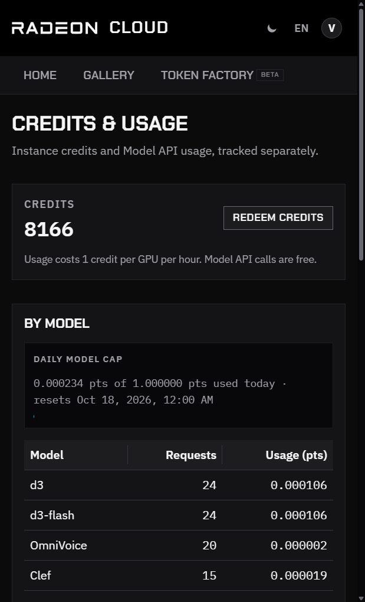
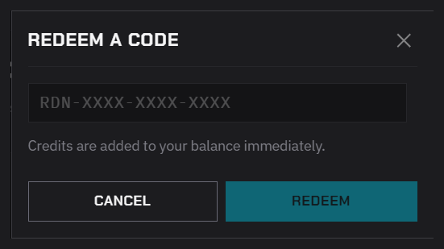

Credits pay for GPU instances, including model services you run on them. Token Factory is free and doesn't use them.

## How credits are spent

- A running instance spends credits every hour. The rate is shown on the size you pick, for example **1 GPU · 16 cores · 55GB · 1 credit / hour**.
- The first hour is charged as soon as the instance starts.
- You need at least one hour's worth of credits to launch.
- When your credits run out, the instance is deleted. Save your work to a persistent `/workspace` before that happens. See [Keep your data](/radeon-cloud-docs/guides/storage/).
- A destroyed instance spends nothing. [Destroy it](/radeon-cloud-docs/guides/destroy/) when you're done; an idle instance still spends credits.

## Check your balance

Click your account in the top-right corner of the console. The menu shows your balance, for example **8,167 credits**.

For details, choose **Credits & Usage**. The page shows your balance and your Token Factory usage.

The balance is also returned by `GET /api/me`. See [Account](/radeon-cloud-docs/api/account/).

## Get credits

- **China site:** exchange AMD AI Developer Program points for a coupon. 1 point buys 1 hour, up to 20 points a day. See [AMD AI Developer Program](/radeon-cloud-docs/guides/developer-program/).
- **Events:** hackathons and workshops may hand out coupons directly.

## Redeem a coupon

1. Open **Credits & Usage** from the account menu.
2. Click **Redeem credits**.
3. In **Redeem a code**, paste the whole coupon and click **Redeem**.

The example in the field is `RDN-XXXX-XXXX-XXXX`, but a coupon from the developer program is a long string of letters, digits and symbols. Paste all of it.

When it works, the console shows how many credits were added, and the balance updates right away. **That code is not valid. Check it and try again.** means the coupon is incomplete, expired, already used, or meant for another site. See [If redemption fails](/radeon-cloud-docs/guides/developer-program/#if-redemption-fails).

Credits belong to the site where you redeem them and can't be moved between the China and Global sites.

## Token Factory usage

Token Factory doesn't spend credits. They have their own daily usage cap, counted in points (pts), which resets at 00:00 Beijing time (UTC+8).

**Credits & Usage** shows:

- **Daily model cap**: how much of today's cap you have used, and when it resets.
- **By model**: requests and usage per model.
- **Recent requests**: the last 24 hours, in your local time zone.

To read the same numbers with your API key, call [`GET /v1/usage`](/radeon-cloud-docs/api/usage/).
