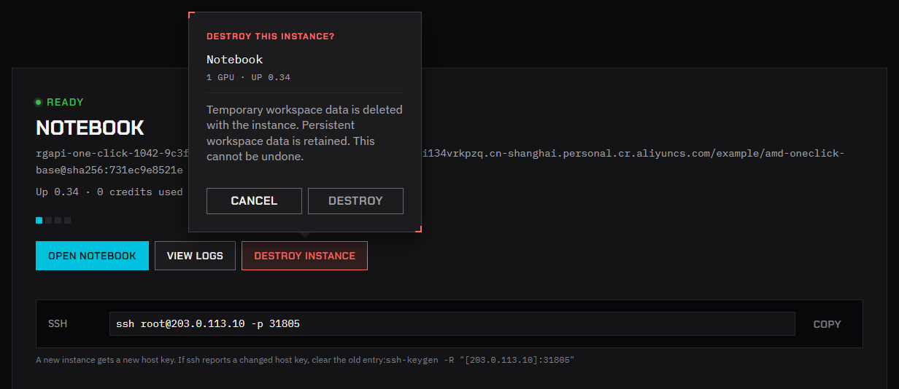
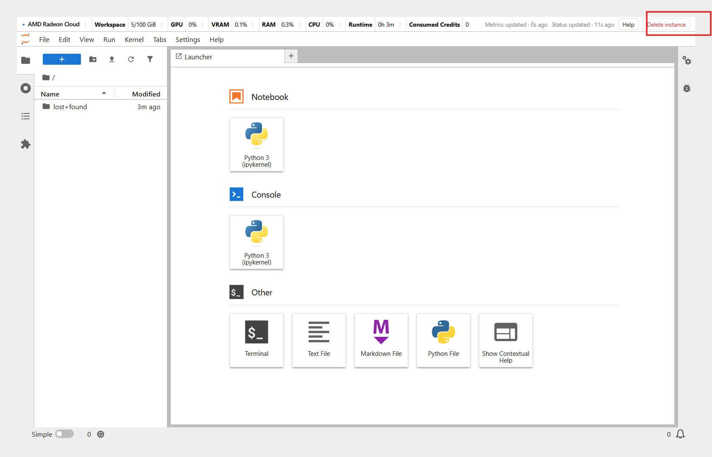

A running instance spends credits whether you use it or not. Destroy it when you're done.

## Destroy from Home

1. Open **Home**. The instance card shows your running instance.
2. Click **Destroy instance**.
3. The confirmation names the instance, its GPUs and how long it has been up, and reminds you that temporary workspace data is deleted and persistent workspace data is kept. Check that it's the right instance and click **Destroy**.

The card shows **Destroying instance**, and credits stop. When it's gone, the launch form comes back.

Destroying usually takes a few seconds.

:::note
Files that are not under a persistent `/workspace` are deleted with the instance. Save them first if you still need them. See [Keep your data](/radeon-cloud-docs/guides/storage/).
:::

## Destroy from JupyterLab

JupyterLab has a **Delete instance** button in its top-right corner. Click it, then click **Destroy** in the confirmation. The confirmation carries the same reminder about temporary and persistent data.

The JupyterLab tab stays open afterwards but no longer works. Close it; **Home** no longer shows a running instance, and the launch form comes back.

## If destroying takes too long

If the card shows **Destroy is taking longer than expected. Refresh, or contact support.** Refresh the page first. If the instance is still there after a few minutes, send the instance ID and a description of the problem to [member-service@mail.developer.amd.com.cn](mailto:member-service@mail.developer.amd.com.cn), and a member of the team will help.

## Instances that are auto-destroyed

When your credits run out, or when the **Auto-delete** time is up, the instance is destroyed. Credits already spent are not refunded, and files you haven't saved are lost. Near the auto-delete time, you can **Extend** once.

## Signing out doesn't stop an instance

Signing out of the console, closing the browser or signing out of the CLI leaves the instance running.

## From the CLI or API

- CLI: `rcc instance delete --yes`. See [Manage GPU instances](/radeon-cloud-docs/cli/instances/).
- API: see [Instances](/radeon-cloud-docs/api/instances/#destroy-the-instance).
