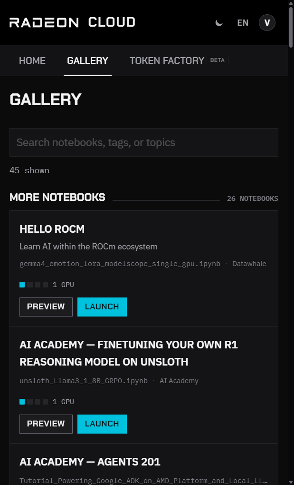

The **Gallery** collects notebooks that are ready to run on Radeon Cloud, such as tutorials, workshop material and demos. Launching one starts an instance with the environment the notebook needs.

## Find a notebook

Open **Gallery** in the console. Notebooks are grouped by category, such as workshops, courses and LLM demos. Each card shows the notebook's title and description, the notebook file it opens, its tags and the number of GPUs it uses.

Search by title, tag or topic; the count next to the search box shows how many notebooks match. Click **Preview** to read a notebook before you launch it.

## Launch it

1. Make sure no instance is running. The **Launch** buttons are disabled while one is.
2. Click **Launch** on the notebook.
3. Follow the launch dialog as for any instance. See [Launch an instance](/radeon-cloud-docs/guides/launch/).
4. When the instance is ready, click **Open notebook**.

The instance uses the image and size set by the notebook's author, or one GPU if the notebook doesn't specify a size. SSH is on, as for every instance. It spends credits like any other instance, so destroy it when you're done.
