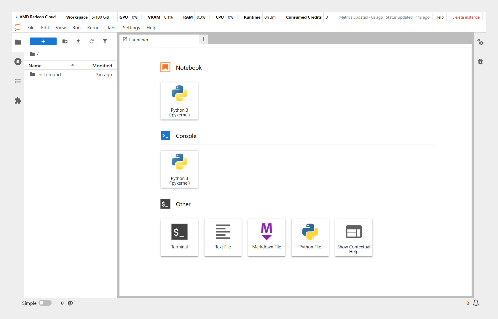

Instances launched with deploy type **Notebook** run JupyterLab. JupyterLab is a development environment in the browser, with notebooks, a terminal and a file browser.

## Open JupyterLab

When the instance is ready, **Open notebook** appears on the launch dialog and on the instance card on **Home**. Click it to enter JupyterLab. The default path is `/workspace`.

Two buttons in the top-right corner come from Radeon Cloud: **Help**, and **Delete instance**, which destroys the instance. See [Destroy an instance](/radeon-cloud-docs/guides/destroy/#destroy-from-jupyterlab).

The bar across the top shows the instance at a glance: **Workspace** storage use, **GPU**, **VRAM**, **RAM** and **CPU** load, **Runtime** and **Consumed Credits**.



## Check the GPU

Open a terminal (**File → New → Terminal**, or the **Terminal** tile in the Launcher) and run:

```bash
rocm-smi
```

It lists the Radeon GPUs attached to the instance with their memory use and temperature. To check that PyTorch can use them:

```bash
python -c "import torch; print(torch.cuda.is_available(), torch.cuda.device_count())"
```

ROCm builds of PyTorch keep the `torch.cuda` API names, so `True` here means ROCm is working.

To see how much GPU memory you have:

```bash
rocm-smi --showmeminfo vram
```

## CPU and memory

CPU and memory available to the instance are set by the size chosen at launch. Commands such as `nproc` and `free` report the host node's resources, which are typically larger than that quota. Set thread counts, workers, and other parallelism from the size, not from those commands.

## Work with files

The file browser on the left is the instance file system. To upload, drag files onto the pane or use the upload control. To download, right-click the file and choose **Download**.

Data that must survive instance destruction belongs under `/workspace`, with persistent storage enabled at launch. See [Keep your data](/radeon-cloud-docs/guides/storage/).

## Cell run status

Code cells are marked by the result of their last run:

- Running: yellow background, ❗
- Succeeded: green background, ✅
- Failed: red background, ❌

The marks exist only in the current browser session. They are not stored in the notebook and disappear on reload. They require JupyterLab 4; images with an older JupyterLab do not show them.

## Long-running jobs

A process started in a notebook cell ends when the kernel stops. Start long-running jobs from a terminal and redirect output to a file:

```bash
nohup python train.py > /workspace/train.log 2>&1 &
tail -f /workspace/train.log
```

The instance is destroyed when credits run out or when **Auto-delete** is reached. Write checkpoints under `/workspace` and launch with persistent storage. See [Keep your data](/radeon-cloud-docs/guides/storage/).

## Reach a service from the internet

Web services inside the instance are not reachable from the public internet by default. To assign a public URL to a Gradio app or a local API, see [Expose a service](/radeon-cloud-docs/guides/tunnel/).
