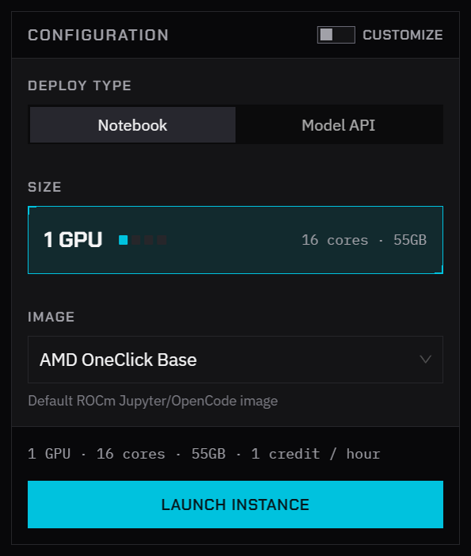
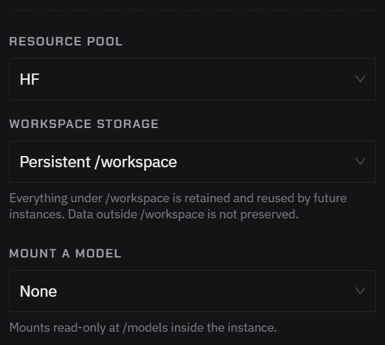
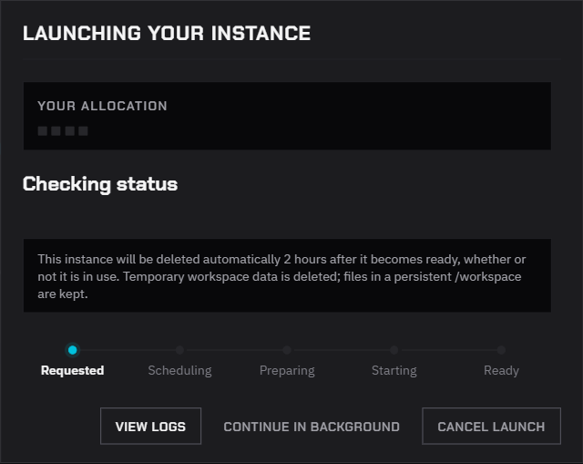
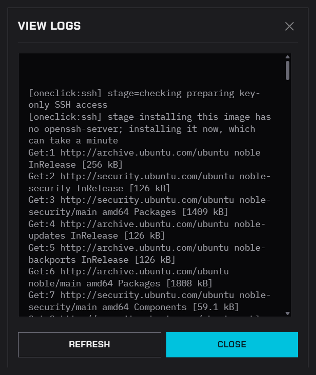
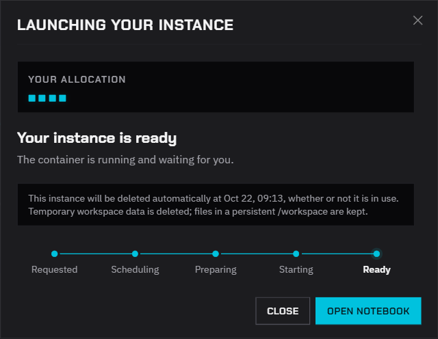
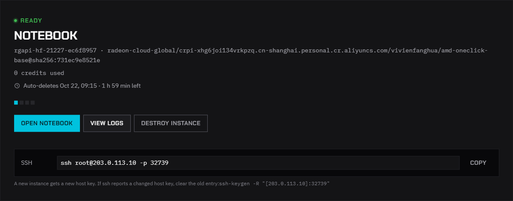
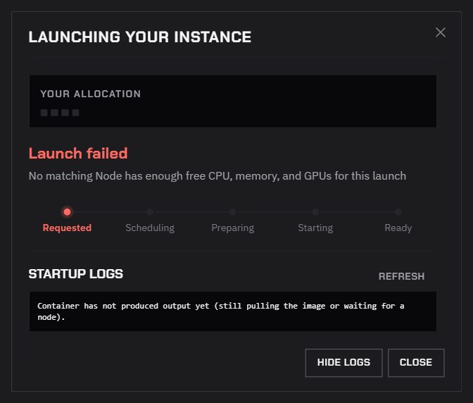

You launch instances from **Home** in the console. This page walks through the launch form, the launch dialog, and the errors you may see.

## Before you start

- Sign in. See [Sign in](/radeon-cloud-docs/guides/login/).
- Check that you have enough credits for at least an hour of the size you want. See [Credits](/radeon-cloud-docs/guides/credits/).
- To use SSH, add a public key in **Settings** first. See [Connect over SSH](/radeon-cloud-docs/guides/ssh/).
- Destroy any instance that is still running. Each account runs one at a time.

## Launch with the defaults

1. Open **Home**.
2. Under **Deploy type**, keep **Notebook**.
3. Under **Image**, keep **AMD OneClick Base** or pick another. See [Choose an image](/radeon-cloud-docs/guides/images/).
4. Click **Launch instance**.

With **Customize** off, the form uses the smallest size available to your account, a temporary workspace, and no mounted model. The line above the button shows what you will get, for example **1 GPU · 16 cores · 55GB · 1 credit / hour**.

**Auto-delete** is on the default form. Choose how long the instance may run after it becomes ready: **2 h**, **8 h**, **1 day**, **3 days**, or **7 days**. The default is **3 days**. The clock starts when the instance is ready and runs whether or not you use it. Running until it is deleted uses up to the credits shown next to the control — 73 credits for 3 days at 1 credit / hour — because every started hour is billed, and deletion can land a few minutes after the deadline. When it is deleted, data in the temporary workspace is lost.

## Customize the launch

Turn on **Customize** to choose the rest.

| Field | How to choose |
|---|---|
| **Size** | Pick the number of GPUs. If a GPU count comes in more than one memory size, a **Memory** row appears; each option shows its credits per hour. Choose the smallest size that fits your model. |
| **Image** | The default suits most work. |
| **Resource pool** | Most accounts have one pool. If yours has several, the form lists them by name, such as **One-click** and **HF**. If a launch fails for lack of capacity, try another. |
| **Workspace storage** | **Temporary workspace (local storage)** is fast and is deleted with the instance. **Persistent /workspace** keeps everything under `/workspace` for your next instance. Some accounts can also pick 25 GB or 100 GB. See [Keep your data](/radeon-cloud-docs/guides/storage/). |
| **Mount a model** | Mounts a prepared model read-only, so you don't have to download it. Most models appear at `/models`; see [Mounted models](/radeon-cloud-docs/guides/storage/#mounted-models). Leave it at **None** if you don't need one. |

Settings can't be changed on a running instance. To change storage or size, destroy the instance and launch again.

To serve a model instead, set **Deploy type** to **Model API**. See [Serve a model](/radeon-cloud-docs/guides/serve-model/).

## Follow the launch

After you click **Launch instance**, the **Launching your instance** dialog moves through **Requested**, **Scheduling**, **Preparing**, **Starting** and **Ready**. The dialog also shows an **Auto-delete** notice. Before the instance is ready, that notice uses the lifetime you picked, for example **2 hours after it becomes ready**. Temporary workspace data will be deleted; files in a persistent `/workspace` are kept.

- **View logs** shows scheduling events and the container's output. Before a node is assigned and the image is pulled, the output stays empty.
- **Continue in background** closes the dialog. The launch keeps going, and **Home** shows the instance when it is ready.
- **Cancel launch** stops the launch.

When a node is free, the instance is usually ready in under a minute. The first launch of an image on a node takes longer, because the node has to download the image.

## When it's ready

The dialog reads **Your instance is ready**. The **Auto-delete** notice now names the clock time, for example **This instance will be deleted automatically at Oct 22, 09:13**. Click **Open notebook** to open [JupyterLab](/radeon-cloud-docs/guides/jupyterlab/) in a new tab.

**Home** now shows the instance card:

- **Open notebook** opens JupyterLab.
- **View logs** shows the startup events and container output.
- **Destroy instance** deletes the instance. See [Destroy an instance](/radeon-cloud-docs/guides/destroy/).
- The card shows the image, how long the instance has been up and the credits it has used.
- **Auto-delete** counts down on the card, in the form **Auto-deletes {time} · {left} left**. It turns amber in the last 24 hours when the original time was more than a day, and red in the last hour. When the time is reached it reads **Auto-delete time reached. Deleting shortly**.
- The SSH command appears once SSH is ready. See [Connect over SSH](/radeon-cloud-docs/guides/ssh/).

## If the launch fails

| Message | What it means | What to do |
|---|---|---|
| **No matching Node has enough free CPU, memory, and GPUs for this launch** | Every node in the selected resource pool is busy. | Turn on **Customize** and pick another **Resource pool** if you have one, or choose a smaller size, or try again later. If your account has only one pool and this keeps happening, email [member-service@mail.developer.amd.com.cn](mailto:member-service@mail.developer.amd.com.cn). |
| **Waiting for a free GPU** | No node has room yet. The launch is still queued. | Keep waiting, or cancel and choose a smaller size or another pool. |
| **Image pull failed** | The node could not download the image. | Try again. If it fails again, pick another image and report the image name to support. |
| **You already have an instance running.** | Your account already has an instance. | Destroy it first. |
| **Resource catalog is unavailable. Try again.** | The console could not load the sizes and pools for your account. | Refresh the page. |

A failed launch does not create an instance and does not spend credits.

For more cases, see [Troubleshooting](/radeon-cloud-docs/resources/troubleshooting/).

## Launch from a terminal

`rcc instance create` launches the same instances from the command line. See [Manage GPU instances](/radeon-cloud-docs/cli/instances/).
