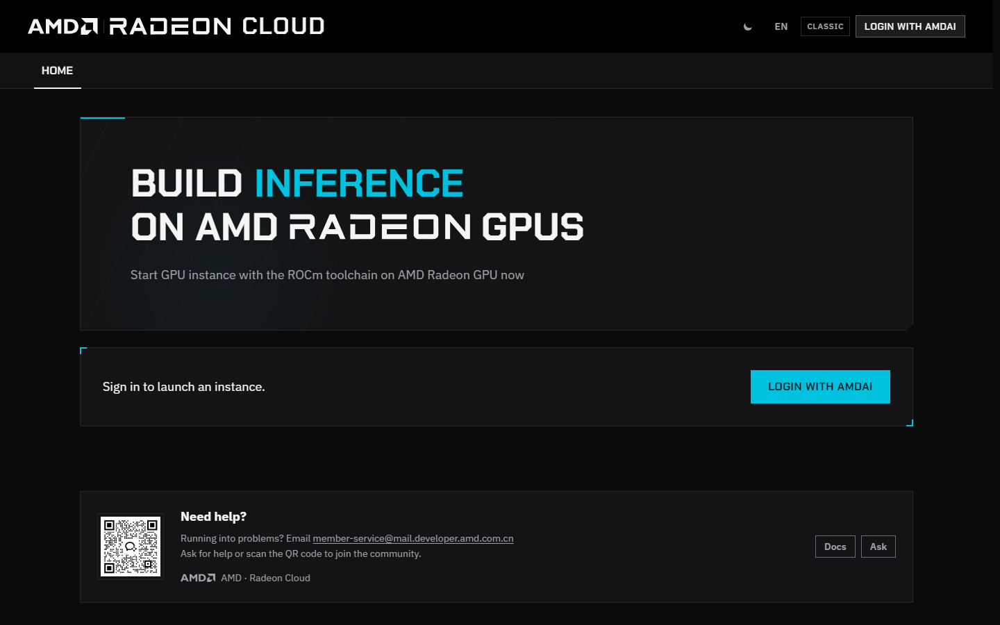
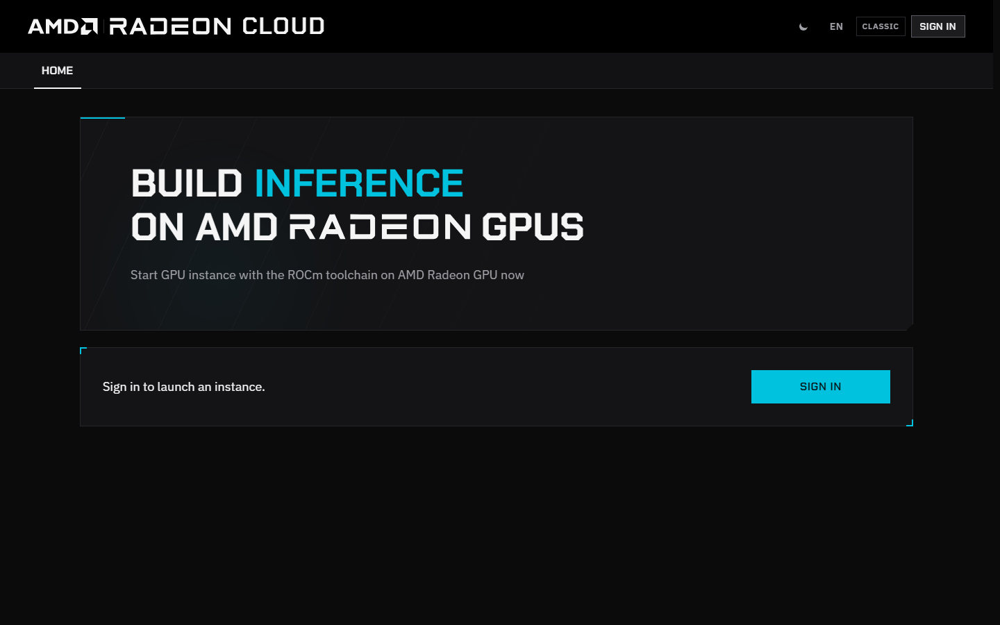
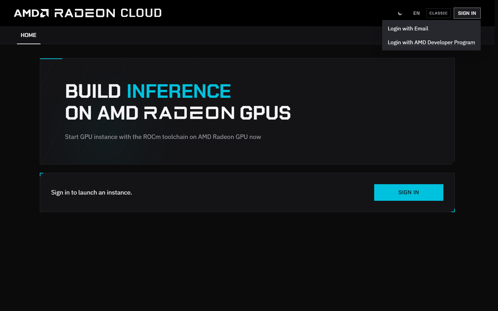
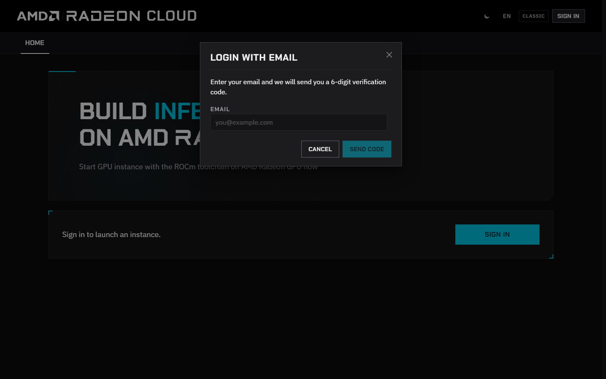
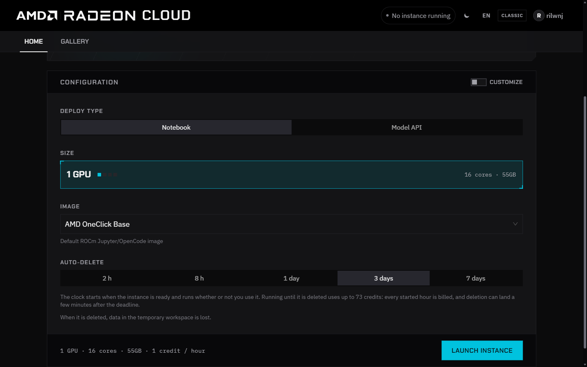

The [China site and the Global site](/radeon-cloud-docs/introduction/#china-site-and-global-site) have separate accounts and different sign-in methods. Use the one for your region.

These docs describe the **new console**. Until you sign in, the nav shows only **Home**. **Gallery** appears after you sign in. **Token Factory** appears on the China site only.

## China site

The China site uses your [AMD AI Developer Program](/radeon-cloud-docs/guides/developer-program/) account. You can sign in at [developer.amd.com.cn](https://developer.amd.com.cn/), or open [developer.amd.com.cn/radeon](https://developer.amd.com.cn/radeon/) and sign in from there. Either way, you end up on the same program login page.

A new browser often opens the classic Gallery first. You can stay on it, or click **Switch to the new design** in the bottom-right corner. See [Classic interface](/radeon-cloud-docs/resources/classic-ui/).

### From the classic Gallery

Click **Login** in the top-right corner.

### From the new console

After **Switch to the new design**, **Home** asks you to sign in. Click **Login with AMDAI**, in the header or on the panel.

### Program login page

The login page has two tabs:

- **验证码登录 / Verification Code Login**: enter your mobile number or email, click **发送验证码 / Send Code**, and type in the code. You may need to pass a slider captcha first. After a code is sent, the button counts down before you can request another.
- **密码登录 / Password Login**: for accounts that already have a password.

Below the form, you can also sign in with a ModelScope (魔搭), CSDN, or GitHub account.

If you don't have an account yet, click **注册账号 / Create Account** on the login page, or **免费注册** on the [program home page](https://developer.amd.com.cn/).

Once you're signed in to the program, you're signed in to the China site too. Your name shows in the top-right corner of the console. The same account holds the developer points that you exchange for [credits](/radeon-cloud-docs/guides/credits/).

## Global site

1. Open [radeon-global.anruicloud.com](https://radeon-global.anruicloud.com/). The console opens on **Home**.
2. Click **Sign in** in the top-right corner, or **Sign in** next to **Sign in to launch an instance.**

3. Choose **Login with Email** or **Login with AMD Developer Program**.

If you chose **Login with Email**, enter your address under **Email** and click **Send code**. Codes expire after a few minutes; if one doesn't arrive, wait for the cooldown and request another.

The header also has **Classic**, which switches to the classic interface, plus the language (**EN** / **中**) and theme controls.

## After signing in

The console stays on **Home**, where you launch instances. The header shows **No instance running** until you launch one. **Gallery** appears in the nav after you sign in. **Token Factory** appears on the China site; the Global site currently does not show it.

Click your account in the top-right corner for:

- your credit balance
- **Credits & Usage**: credits and redeeming coupons. On the China site this page also shows Token Factory usage. See [Credits](/radeon-cloud-docs/guides/credits/).
- **Settings**: SSH keys, language, appearance, linking an AMD Developer Program account, and the switch to the classic interface
- **Sign out**

If your console has a **Profile** page instead, you're on the classic interface. See [Classic interface](/radeon-cloud-docs/resources/classic-ui/).

## Settings

Open **Settings** from the account menu.

- **SSH keys**: add the public keys that can connect to instances you launch later. See [Connect over SSH](/radeon-cloud-docs/guides/ssh/).
- **Language**: **EN** or **中**. The header **EN** / **中** control does the same thing.
- **Appearance**: light or dark theme.
- **AMD Developer Program**: on the Global site, link the program account if you sign in with it. On the China site, **AMDAI account** should read **Linked**.
- **Interface**: **Use classic** switches to the classic console. See [Classic interface](/radeon-cloud-docs/resources/classic-ui/).

## If your account needs review

Some new accounts are reviewed before they can be used. Until the review is done, signing in shows a review page instead of the console, you can't launch instances, and you don't get an API key. Everything unlocks once the account is approved.

If the review takes longer than expected, email [member-service@mail.developer.amd.com.cn](mailto:member-service@mail.developer.amd.com.cn) with your account email.
