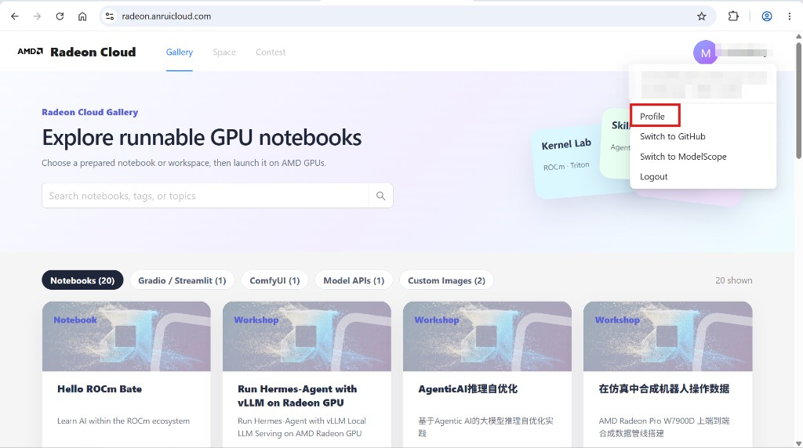

The [China site and the Global site](/radeon-cloud-docs/introduction/#china-site-and-global-site) have separate accounts and different sign-in methods. Use the one for your region.

## China site

The China site uses your [AMD AI Developer Program](/radeon-cloud-docs/guides/developer-program/) account. You can sign in at [developer.amd.com.cn](https://developer.amd.com.cn/), or click **Login** in the top-right corner of [developer.amd.com.cn/radeon](https://developer.amd.com.cn/radeon/). Either way, you end up on the same program login page.

The login page has two tabs:

- **验证码登录 / Verification Code Login**: enter your mobile number or email, click **发送验证码 / Send Code**, and type in the code. You may need to pass a slider captcha first. After a code is sent, the button counts down before you can request another.
- **密码登录 / Password Login**: for accounts that already have a password.

Below the form, you can also sign in with a ModelScope (魔搭), CSDN, or GitHub account.

If you don't have an account yet, click **注册账号 / Create Account** on the login page, or **免费注册** on the [program home page](https://developer.amd.com.cn/).

Once you're signed in to the program, you're signed in to the China site too. Your name shows in the top-right corner of the console. The same account holds the developer points that you exchange for [credits](/radeon-cloud-docs/guides/credits/).

## Global site

Open [radeon-global.anruicloud.com](https://radeon-global.anruicloud.com/), click **Login** in the top-right corner, and choose **Login with Email**.

Enter your email address and the six-digit code sent to it. Codes expire after a few minutes; if one doesn't arrive, wait for the cooldown and request another.

## After signing in

Click your avatar in the top-right corner and choose **Profile**. This page is where you manage everything: templates, the running instance, your SSH key, your API key, and your credit balance.

## If your account needs review

Some accounts are held for verification before they can launch instances. If you see a notice to that effect, you can still browse the console and use the [free shared model APIs](/radeon-cloud-docs/guides/model-apis/) — launching a GPU instance unlocks once the review completes.
