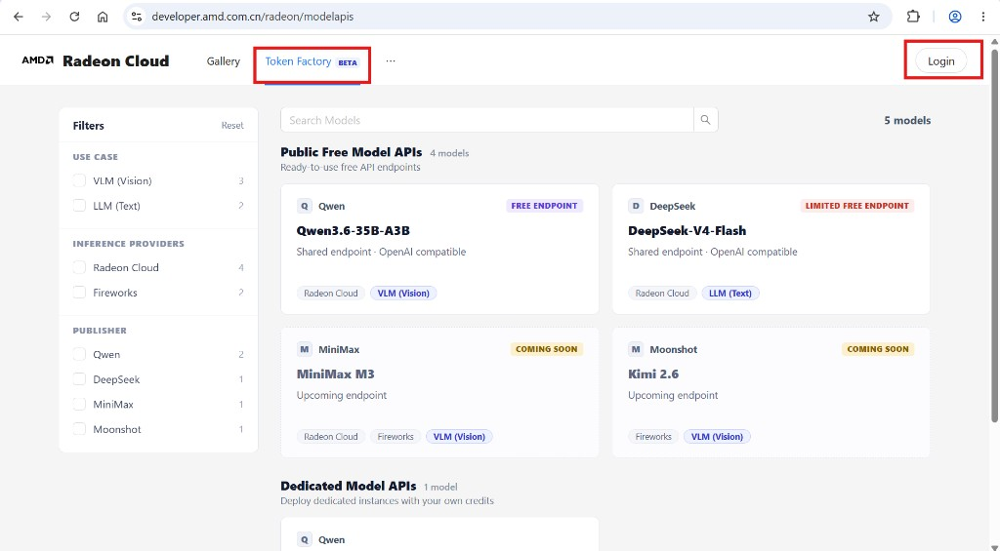
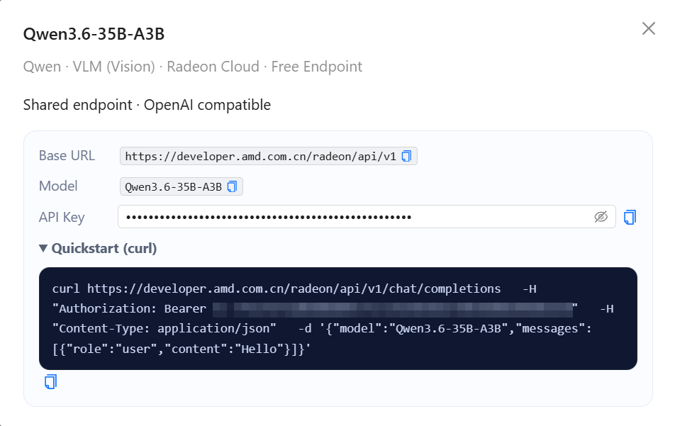

AMD Radeon Cloud serves models behind an OpenAI-compatible HTTP API. Any client that talks to OpenAI works by changing the base URL and the key: `curl`, the `openai` SDK, LangChain, Cherry Studio.

You have two options. The difference is whose GPU runs the model.

## Free shared endpoints

Shared endpoints are always on and cost nothing. No instance to launch, no credits spent. The platform picks which models are available.

Open the [Token Factory](https://developer.amd.com.cn/radeon/modelapis) and sign in.



Under **Public Free Model APIs**, pick a model. The detail dialog shows the base URL, the model name, your API key, and a ready-to-run curl command.



```bash
curl https://developer.amd.com.cn/radeon/api/v1/chat/completions \
  -H "Authorization: Bearer $RADEON_API_KEY" \
  -H "Content-Type: application/json" \
  -d '{"model":"DeepSeek-V4-Flash","messages":[{"role":"user","content":"Hello"}]}'
```

One key covers every shared model. To use a different one, change the `model` field.

Shared endpoints support **chat completions** and **listing models**. Requests are rate limited per key and per IP, and a daily spend cap applies — see [Rate limits](/radeon-cloud-docs/api/rate-limits/).

## Dedicated endpoints

A dedicated endpoint runs the model on your own instance, so you choose the model and the serving configuration. It uses credits for as long as the instance is up.

1. On **Home**, set **Deploy type** to **Model API**.
2. Under **Model**, pick a public template. It fixes the model, the size and the vLLM command for you. To serve another model, click **Custom Model** and fill in:
   - **Model name**: the name clients send in the `model` field.
   - **Model source**: **Hugging Face (mirror)** or **ModelScope**, wherever the weights come from.
   - **vLLM Command**: the serve command, for example:

     ```bash
     vllm serve Qwen/Qwen2.5-0.5B-Instruct --host 0.0.0.0 --port 8000 --served-model-name Qwen2.5-0.5B-Instruct
     ```

3. Choose a **Size** with enough GPU memory for the model, then click **Launch instance**.
4. When the instance is ready, the **OpenAI-compatible endpoint** card shows the **Base URL**, the **Model** and your **API key**, with a ready-to-run curl command.

:::caution[Keep `--host 0.0.0.0 --port 8000`]
The platform routes the endpoint to port 8000 inside the container. If the server binds anywhere else, the endpoint won't reach it. Keep `--served-model-name` equal to **Model name**.
:::

Call it like a shared endpoint, with the base URL from the card:

```bash
curl <base-url>/chat/completions \
  -H "Authorization: Bearer $RADEON_API_KEY" \
  -H "Content-Type: application/json" \
  -d '{"model":"Qwen2.5-0.5B-Instruct","messages":[{"role":"user","content":"Hello"}]}'
```

Because the request goes straight to vLLM or SGLang, a dedicated endpoint exposes whatever that server exposes — typically completions and embeddings in addition to chat.

## Choosing

Start with shared endpoints. Move to a dedicated one when you need a model that isn't in the catalog, want control over serving parameters, or need throughput that isn't shared with other users.

Full request and response details are in the [API reference](/radeon-cloud-docs/api/overview/).
