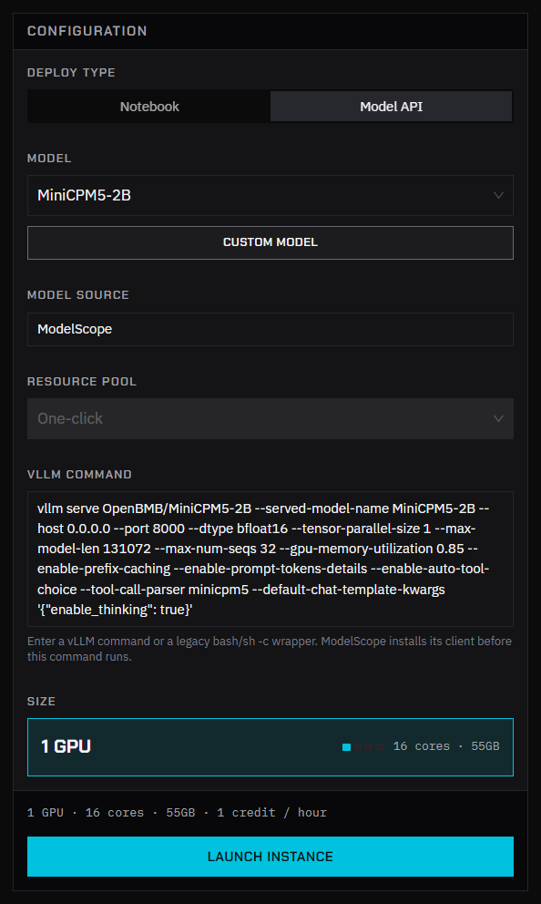
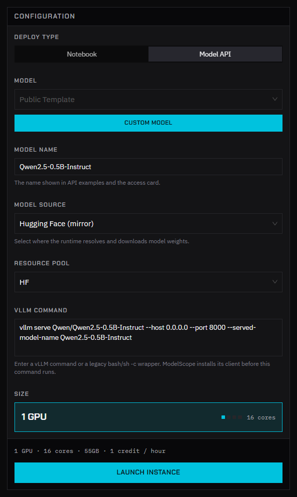
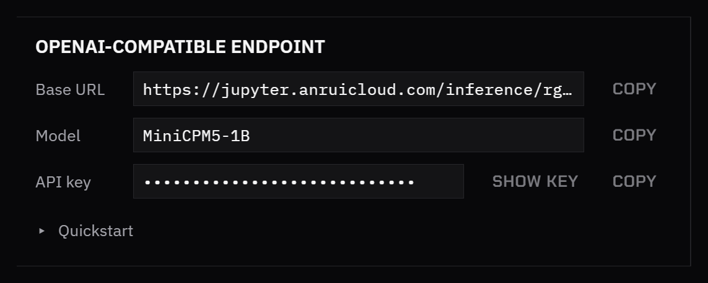

In the launch form, **Deploy type: Model API** starts an instance that runs vLLM instead of JupyterLab and gives you an OpenAI-compatible endpoint for it. You choose the model and its settings, nobody else shares the GPU, and the instance spends credits every hour it runs.

This is separate from [Token Factory](/radeon-cloud-docs/guides/token-factory/), where the platform hosts the models for free. Use a model service when you need a model Token Factory doesn't offer, your own vLLM settings, or throughput you don't share with anyone.

## Launch from a public template

Public templates come with a tested model, size and vLLM command.

1. On **Home**, set **Deploy type** to **Model API**.
2. Under **Model**, pick a public template, for example **MiniCPM5-2B**. The form shows the template's **Model source**, **Resource pool**, **vLLM Command** and **Size**, and you can't change them.
3. Click **Launch instance** and follow the launch dialog. See [Launch an instance](/radeon-cloud-docs/guides/launch/#follow-the-launch).



The templates available to you are listed in the **Model** field. If there are none, the form says so; use a custom model instead.

## Launch a custom model

1. On **Home**, set **Deploy type** to **Model API** and click **Custom Model**.
2. Fill in the form:

   | Field | What to enter |
   |---|---|
   | **Model name** | The name clients send in the `model` field. It also appears in the API examples. |
   | **Model source** | Where the weights come from: **Hugging Face (mirror)** or **ModelScope**. With ModelScope, the platform installs its client before your command runs. |
   | **Resource pool** | The pool to run in. Most accounts have one. |
   | **vLLM Command** | The command that starts the server. |
   | **Size** | Pick a size whose GPU memory fits the model weights plus the KV cache. |

3. Click **Launch instance**.



The form starts with an example for each source:

```bash
vllm serve Qwen/Qwen2.5-0.5B-Instruct --host 0.0.0.0 --port 8000 --served-model-name Qwen2.5-0.5B-Instruct
```

:::caution[Keep `--host 0.0.0.0 --port 8000`]
The platform routes the endpoint to port 8000 inside the instance. A server bound anywhere else can't be reached. Set `--served-model-name` to the same value as **Model name**.
:::

The first launch of a model downloads its weights, so it takes longer than later launches.

## Call the endpoint

When the instance is ready, the **OpenAI-compatible endpoint** card shows:

- **Base URL**: the endpoint of your instance.
- **Model**: the value for the `model` field.
- **API key**: the key for this endpoint. It starts with `sk-`, is created for each launch, and isn't your Token Factory [API key](/radeon-cloud-docs/guides/token-factory/#get-your-api-key).
- **Quickstart**: a ready-to-run curl command.



```bash
curl <base-url>/chat/completions \
  -H "Authorization: Bearer <api-key>" \
  -H "Content-Type: application/json" \
  -d '{"model":"Qwen2.5-0.5B-Instruct","messages":[{"role":"user","content":"Hello"}]}'
```

Requests go straight to vLLM, so the endpoint exposes what vLLM exposes, such as `/v1/completions` and `/v1/embeddings`. Token Factory's rate limits and request filtering don't apply. See [Model service endpoints](/radeon-cloud-docs/api/model-services/).

Copy the **Base URL** and **API key** from the card after each launch rather than saving them in code.

## Stop it

The endpoint works only while the instance runs. Destroy the instance when you're done: on **Home**, click **Destroy instance**. See [Destroy an instance](/radeon-cloud-docs/guides/destroy/).

## If it doesn't respond

- Open **View logs** on the instance card. vLLM prints errors there, for example when the model doesn't fit in GPU memory.
- Check that the command has `--host 0.0.0.0 --port 8000`.
- Check that the `model` field matches **Model name**.

See [Troubleshooting](/radeon-cloud-docs/resources/troubleshooting/#a-model-service-doesnt-respond).
