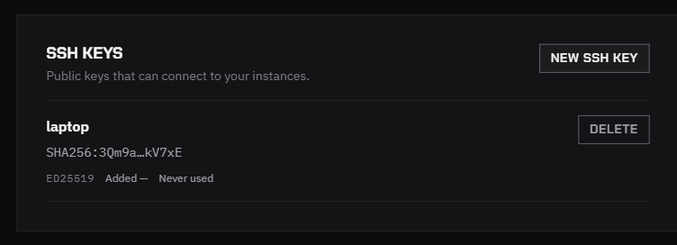

SSH lets you use the instance from your own terminal and editor. Add your public key in Settings **before** you launch: an instance launched without a key has no SSH, and adding a key later doesn't change that, so relaunch it. A saved key is used for every later launch.

## Add your public key

1. If you don't have a key pair yet, create one. This works on macOS, Linux and Windows PowerShell:

   ```bash
   ssh-keygen -t ed25519 -C "laptop"
   ```

   It writes the private key to `~/.ssh/id_ed25519` and the public key to `~/.ssh/id_ed25519.pub`.

2. Print the public key and copy it:

   ```bash
   cat ~/.ssh/id_ed25519.pub
   ```

3. In the console, open **Settings** and click **New SSH key**.
4. Enter a **Title** such as the computer's name, paste the key into **Key**, and click **New SSH key** in the dialog.

The key is listed with its title and fingerprint. You can add one key for each computer you use, up to 10 keys.



:::danger[Paste only the .pub file]
A public key starts with `ssh-ed25519` or `ssh-rsa` and comes from the file ending in `.pub`. Never paste the private key.
:::

Keys apply to instances launched after you add them. An instance that is already running keeps the keys it started with.

## How SSH is set up

When an instance starts, the platform sets up SSH next to the notebook. JupyterLab is usable the whole time, so the instance can be ready while SSH is still being prepared. The platform works in four steps:

1. **Check.** It looks for your public key and for an SSH server (`sshd`) in the image.
2. **Install, only if the image has no SSH server.** On Ubuntu and Debian it runs `apt-get update` and `apt-get install openssh-server` against the distribution's own package repositories. Other repositories in the image are ignored. On RHEL-family, Fedora and Amazon Linux it uses `dnf` or `yum`, and on Alpine it uses `apk`. Other operating systems are not supported. Each package step is stopped after 300 seconds.
3. **Configure.** It writes the SSH server configuration, creates host keys and adds your public keys. Login is by key only. Passwords, port forwarding, X11 forwarding and agent forwarding are turned off.
4. **Start.** It starts `sshd` and checks that it is running. Then the card shows **SSH is ready** and the SSH command.

Catalog images such as Base already include an SSH server, so they skip step 2 and are ready sooner. Other images, including some template and custom images, may not include one.

### What affects the setup

- **Whether the image includes an SSH server.** This is the main factor. Without one, the platform has to download and install it every time an instance starts.
- **Speed of the package download.** Packages come through the platform's controlled network. When the network is slow, which can happen at busy times, the download can pass the 300 second limit and the install fails.
- **Operating system.** Only the families listed in step 2 are installed automatically.
- **How the image runs.** The image must run as `root`, have a writable root file system, and provide the `timeout` command.
- **Your public key.** At least one valid key must be saved in **Settings** before you launch.

## Wait for SSH

SSH starts a little after the instance. While it is being set up, the instance card shows **Setting up SSH — do not connect yet**. JupyterLab already works at this point. The card also shows the current step in small type, for example while the SSH server is being installed.

When SSH is ready, the card shows **SSH is ready** and the SSH command.

## Connect

Click **Copy** next to the command on the instance card and run it in your terminal. It has this form:

```bash
ssh root@<host> -p <port>
```

You log in as `root`. The first time you connect, type `yes` to accept the host key.

If your key isn't the default one, add `-i` and the path to the private key.

### "Remote host identification has changed"

A new instance can reuse a host and port that an earlier instance had, with a new host key. If `ssh` warns that the host key has changed, remove the old entry with the command shown on the instance card, then connect again:

```bash
ssh-keygen -R "[<host>]:<port>"
```

## Copy files

Use `scp` or `rsync` with the same host, port and user as the SSH command, for example:

```bash
scp -P <port> results.tar.gz root@<host>:/workspace/
```

## Connect from the CLI

`rcc instance ssh` connects without copying the command. See [Manage GPU instances](/radeon-cloud-docs/cli/instances/).

## SSH could not be set up

If the card shows **SSH could not be set up**, SSH isn't reachable on this instance, but JupyterLab is unaffected. The card shows the reason, and the current step in small type, with a link to this section. The SSH command stays below the message, so once you have installed SSH yourself you can connect with it.

- `OpenSSH installation failed`

  The download or install didn't finish. The usual cause is a slow or unreachable package repository, or the 300 second limit. **What to do:** try again later, or [install SSH yourself](#install-ssh-yourself).

- `OpenSSH package source is unavailable`

  The package repository couldn't be reached. **What to do:** the same as above.

- `The image does not ship openssh-server. Install it inside the notebook, then start sshd.`

  The image has no SSH server and it wasn't installed automatically. **What to do:** [install SSH yourself](#install-ssh-yourself).

- `Automatic OpenSSH installation supports Ubuntu, Debian, RHEL-family, Fedora, Amazon Linux, and Alpine images`

  The image's operating system isn't supported for automatic install. **What to do:** [install SSH yourself](#install-ssh-yourself) if your system has a package for it, or launch with another image.

- `Image does not provide the timeout command`

  The image has no `timeout` command, which the automatic install needs. **What to do:** [install SSH yourself](#install-ssh-yourself).

- `Image root filesystem does not allow OpenSSH installation`

  The image's root file system is read-only. **What to do:** launch with another image.

- `SSH setup requires a root runtime`

  The image doesn't run as `root`. **What to do:** launch with another image.

- `SSH public key is missing` or `SSH public key is invalid`

  The instance didn't get a usable public key. **What to do:** check **Settings → SSH keys**, then destroy the instance and launch again.

- `SSH configuration failed`, `SSH host key generation failed`, `SSH server configuration is invalid` or `SSH server failed to start`

  The SSH server is installed, but it couldn't be configured or started. **What to do:** destroy the instance and launch again. If it happens again, [email support](/radeon-cloud-docs/resources/troubleshooting/#still-stuck).

Any other message means the setup stopped for a reason that isn't listed above. Read the line in small type under the message, then try again or email support.

You have three choices:

- **Install SSH yourself.** This takes a few minutes and is described below.
- **Launch again,** ideally at a quieter time. A new instance repeats the setup, and a slow package repository is often temporary.
- **Launch with an image that includes an SSH server.** Then there is nothing to download.

### Install SSH yourself

Open a terminal in JupyterLab. The commands assume you are `root`, which is the default user on these instances.

1. Install the SSH server. On Ubuntu and Debian:

   ```bash
   apt-get update
   apt-get install -y --no-install-recommends openssh-server
   ```

   On other systems, use their package manager instead:

   ```bash
   dnf install -y openssh-server    # RHEL-family, Fedora, Amazon Linux (or yum)
   apk add --no-cache openssh       # Alpine
   ```

   If the download is slow or stalls, wait and run the command again, or try at a quieter time.

2. Create the folders and add your public key. Replace `<your public key>` with the whole line from your `.pub` file, the same one you added in **Settings**. If you use several computers, add one line for each.

   ```bash
   mkdir -p /run/sshd /root/.ssh
   chmod 700 /root/.ssh
   echo '<your public key>' >> /root/.ssh/authorized_keys
   chmod 600 /root/.ssh/authorized_keys
   ```

3. Create the host keys:

   ```bash
   ssh-keygen -A
   ```

4. Start the SSH server with key login only and no port forwarding, as the platform does:

   ```bash
   /usr/sbin/sshd -o PasswordAuthentication=no -o AllowTcpForwarding=no
   ```

5. Check that it is running. This works even if the image has no `ps` command:

   ```bash
   grep -l '^sshd$' /proc/[0-9]*/comm
   ```

   It prints one or more lines such as `/proc/123/comm`. If it prints nothing, `sshd` isn't running: run step 4 again and read the error it shows.

Then connect from your own terminal as described in [Connect](#connect). The host key is new, so you may need the `ssh-keygen -R` command from that section.

:::caution[What is different from the automatic setup]
- The SSH server you started stays up only as long as the container. If the instance restarts, SSH and what you set up may be gone, so repeat the steps.
- The platform sets proxy variables in the SSH sessions it starts. A session on your own SSH server doesn't have them. If `pip`, `git` or Hugging Face downloads need the proxy, copy the values from the JupyterLab terminal with `env | grep -i proxy` and `export` them in your SSH session.
- The instance card keeps showing **SSH could not be set up**, because it only reports the platform's own setup. The SSH command stays on the card below the message, so copy it from there to connect.
:::

## Limits of SSH

- **No port forwarding or tunnels.** The SSH server closes forwarding, so `ssh -L`, `ssh -R`, `ssh -D` and jump hosts (`ProxyJump`) don't work. You can't forward JupyterLab, TensorBoard or any other port to your computer through SSH. Open JupyterLab from the console instead.
- **Tools that connect through an SSH tunnel can't connect.** This covers any tool that starts a server on the instance and talks to it through SSH, or that has an "SSH tunnel" option. Examples are the remote development features of editors and IDEs (such as VS Code, Cursor and JetBrains), remote debuggers, and database or other clients that reach a service on the instance through SSH.
- **What does work.** An interactive terminal session, running a single command (`ssh ... <command>`), `scp`, `sftp` and `rsync`, and `rcc instance ssh`. Edit files in JupyterLab.
- **Key login only.** Password login isn't available. The login user is `root`.
- **Keys are fixed at launch.** A key added later applies only to instances launched after that.
