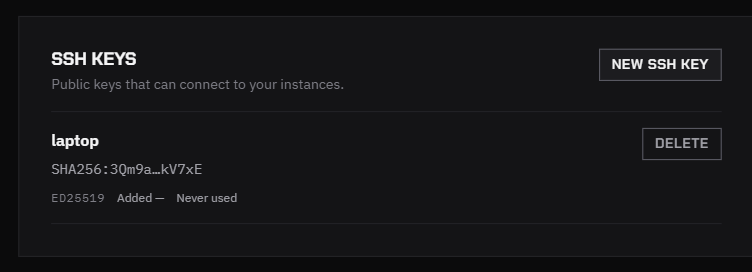

SSH lets you use the instance from your own terminal and editor. Every instance launched from the console has SSH. You only need to add your public key once.

## Add your public key

1. If you don't have a key pair yet, create one. This works on macOS, Linux and Windows PowerShell:

   ```bash
   ssh-keygen -t ed25519 -C "laptop"
   ```

   It writes the private key to `~/.ssh/id_ed25519` and the public key to `~/.ssh/id_ed25519.pub`.

2. Print the public key and copy it:

   ```bash
   cat ~/.ssh/id_ed25519.pub
   ```

3. In the console, open **Settings** and click **New SSH key**.
4. Enter a **Title** such as the computer's name, paste the key into **Key**, and click **New SSH key** in the dialog.

The key is listed with its title and fingerprint. You can add one key for each computer you use, up to 10 keys.



:::danger[Paste only the .pub file]
A public key starts with `ssh-ed25519` or `ssh-rsa` and comes from the file ending in `.pub`. Never paste the private key.
:::

Keys apply to instances launched after you add them. An instance that is already running keeps the keys it started with.

## Wait for SSH

SSH starts a little after the instance, because the platform installs and configures the SSH server when the image doesn't include one. While it is being set up, the instance card shows **Setting up SSH — do not connect yet**. JupyterLab already works at this point.

When SSH is ready, the card shows the SSH command.

## Connect

Click **Copy** next to the command on the instance card and run it in your terminal. It has this form:

```bash
ssh root@<host> -p <port>
```

You log in as `root`. The first time you connect, type `yes` to accept the host key.

If your key isn't the default one, add `-i` and the path to the private key.

### "Remote host identification has changed"

A new instance can reuse a host and port that an earlier instance had, with a new host key. If `ssh` warns that the host key has changed, remove the old entry with the command shown on the instance card, then connect again:

```bash
ssh-keygen -R "[<host>]:<port>"
```

### SSH could not be set up

If the card shows **SSH could not be set up**, SSH isn't reachable on this instance, but JupyterLab is unaffected. Work in JupyterLab, or destroy the instance and launch again.

## Copy files

Use `scp` or `rsync` with the same host, port and user as the SSH command, for example:

```bash
scp -P <port> results.tar.gz root@<host>:/workspace/
```

## Connect from the CLI

`rcc instance ssh` connects without copying the command. See [Manage GPU instances](/radeon-cloud-docs/cli/instances/).
