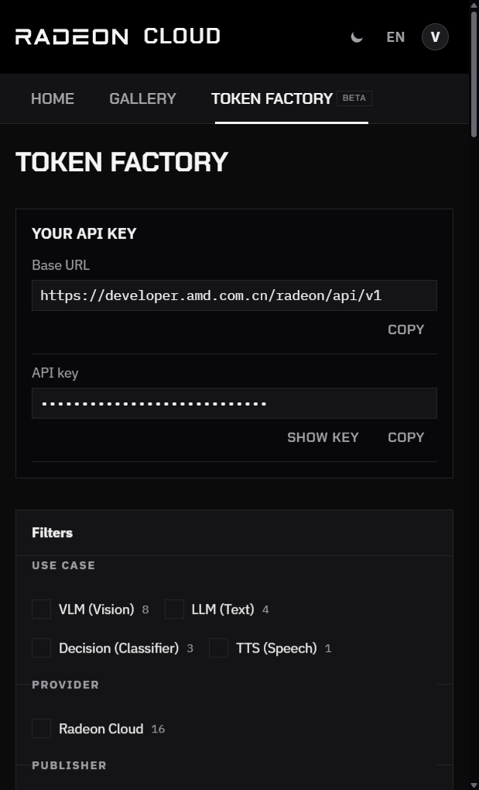

Token Factory hosts a set of models on Radeon GPUs and serves them through an OpenAI-compatible API. There's nothing to launch and no credits to spend: copy your API key and send requests. Any OpenAI client, such as `curl`, the `openai` SDK, LangChain or Cherry Studio, works once you change the base URL and the key.

Token Factory is on the China site only. The platform chooses the models and changes them from time to time. To run a model that isn't listed, or with your own vLLM settings, [serve it on a GPU instance](/radeon-cloud-docs/guides/serve-model/) instead.

## Get your API key

1. Sign in to the console and open **Token Factory**.
2. The **Your API key** card at the top shows the **Base URL** and your **API key**. The key is hidden; click **Show key** to see it or **Copy** to copy it.



The key starts with `rc-` and works for every model in Token Factory. Keep it secret: anyone who has it can spend your daily allowance. See [Authentication](/radeon-cloud-docs/api/authentication/) for rotating a key.

## Pick a model

Token Factory lists its models. Filter them by **Use case**, **Provider** or **Publisher**, or search by name. Each card shows whether the model is busy right now.

Click a card to see the model's description, its pricing and how to call it. The value to send in the `model` field is shown there. The [Model catalog](/radeon-cloud-docs/models/overview/) describes what each model accepts.

Prices are in points (pts) per million tokens, for example **0.14 pts / 1M tokens**. A model billed by input characters, such as OmniVoice, is priced per million characters instead, and its card says so. Points measure usage against your [daily cap](#limits). They aren't money, and they aren't credits.

## Make a request

```bash
export RADEON_API_KEY=rc-...

curl https://developer.amd.com.cn/radeon/api/v1/chat/completions \
  -H "Authorization: Bearer $RADEON_API_KEY" \
  -H "Content-Type: application/json" \
  -d '{"model":"DeepSeek-V4-Flash","messages":[{"role":"user","content":"Hello"}]}'
```

From Python, point the OpenAI SDK at the same base URL:

```python
from openai import OpenAI

client = OpenAI(base_url="https://developer.amd.com.cn/radeon/api/v1", api_key="rc-...")
response = client.chat.completions.create(
    model="DeepSeek-V4-Flash",
    messages=[{"role": "user", "content": "Hello"}],
)
print(response.choices[0].message.content)
```

To use another model, change `model`. To list the models your key can call:

```bash
curl https://developer.amd.com.cn/radeon/api/v1/models \
  -H "Authorization: Bearer $RADEON_API_KEY"
```

Token Factory also accepts the Anthropic Messages API, for clients such as Claude Code. See [Messages](/radeon-cloud-docs/api/messages/). Every operation is described in the [API reference](/radeon-cloud-docs/api/overview/#token-factory-api).

## Limits

Token Factory is free, but usage is capped:

- Requests per minute and concurrent requests are limited per account and per key.
- A daily usage cap, counted in points (pts), resets at 00:00 Beijing time (UTC+8).

When you hit a limit, the request returns `429` with a `Retry-After` header. Every response carries your remaining allowance in its headers. See [Rate limits](/radeon-cloud-docs/api/rate-limits/) and [Usage and quota](/radeon-cloud-docs/api/usage/). Your usage is also on **Credits & Usage** in the console.

If you keep hitting the limits, [serve the model on your own instance](/radeon-cloud-docs/guides/serve-model/) instead.

## Terms

Token Factory is a free trial and development service, not for production. Reselling access is not allowed. See [API terms of use](/radeon-cloud-docs/api/terms/).
