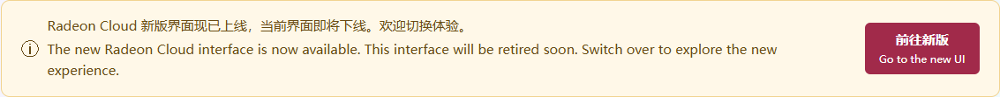

These docs describe the new console. If your console looks different, with a **Profile** page and **My Templates**, you are on the classic interface.

On the China site, signing in often opens the classic interface first. A banner on **Home** and **Profile** says the new interface is available and this one will be retired soon. Click **Go to the new UI** / **前往新版**.

## Switch interfaces

- From the classic interface, click **Go to the new UI** on the banner, or **Switch to the new design**.
- From the new interface, click **Classic** in the header, or open **Settings** and click **Use classic** under **Interface**.
- On the new interface, replay **Product tour** from the account menu.

The choice is remembered in your browser.

## Where things moved

| Classic interface | New interface |
|---|---|
| **Profile → My Templates**, then **Launch** on a template | **Home**: the launch form. You choose the image, size and storage directly, without a template. |
| **Profile → Active Instance** | **Home**: the instance card. |
| **Profile → SSH Public Keys** | **Settings → SSH keys** |
| **Profile → Credits Available → Redeem Credits** | **Credits & Usage** |
| **Profile → Model API Key** | **Token Factory**. **Regenerate Key** is only in the classic interface for now. |
| Template **Deploy Type: vLLM Model API** | **Home → Deploy type: Model API** |
| **Gallery** | **Gallery** |
| **Custom Images** | Still in the classic interface. Finished images show up in the new launch form's **Image** list. |

Templates you created in the classic interface stay there. The new **Home** page launches without templates.
