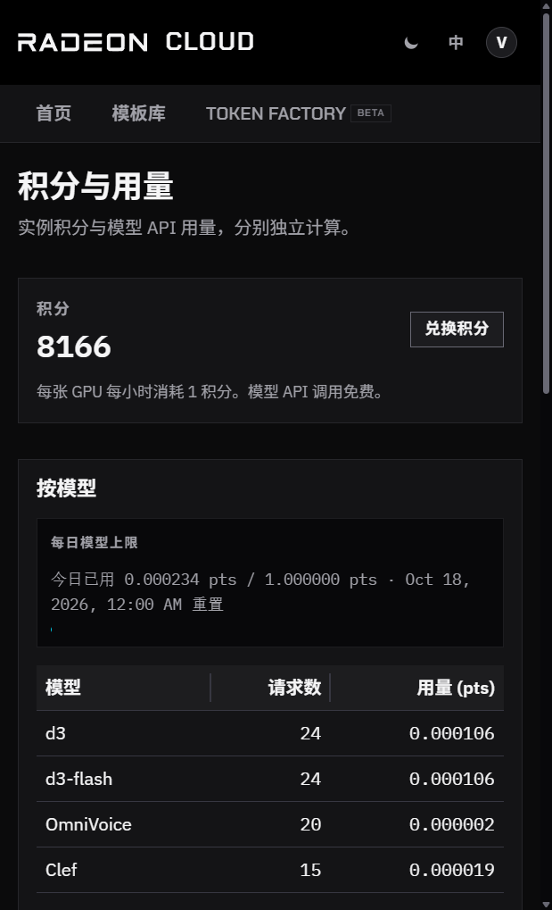
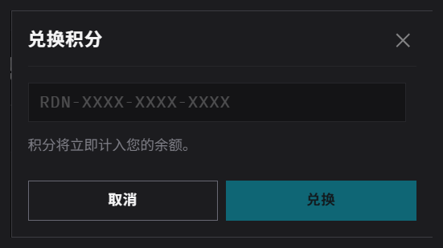

Radeon Cloud 用 **积分** 支付 GPU 实例的费用（英文界面叫 Credits）。实例上自己部署的模型服务也算在内。Token Factory 免费，不消耗积分。

积分和 AMD AI 开发者计划的 **开发者积分** 是两回事。开发者积分可以兑换成积分，见 [AMD AI 开发者计划](/radeon-cloud-docs/zh-cn/guides/developer-program/)。

## 积分怎么消耗

- 实例运行期间每张 GPU 每小时消耗 1 积分，消耗速度标在所选规格上，例如 **1 GPU · 16 核 · 55GB · 1 积分 / 小时**。
- 实例就绪后一两分钟内扣除第一个小时的积分，之后每开始一个小时扣一次。
- 余额至少要够第一个小时。在全球站，余额不够时无法启动；在中国站，启动不会被拦下，但第一个小时扣不出积分时，实例会立即被删除。
- 积分用完时实例会被删除。在那之前请把工作保存到持久化的 `/workspace`，见[保存数据](/radeon-cloud-docs/zh-cn/guides/storage/)。
- 销毁后的实例不再消耗积分。用完请及时[销毁](/radeon-cloud-docs/zh-cn/guides/destroy/)，闲置的实例同样会消耗积分。

## 查看余额

点控制台右上角的账号，菜单里会显示余额，例如 **8,167 积分**。

要看详情，选 **积分与用量**。这个页面总会显示积分余额。中国站还会显示 Token Factory 用量。

`GET /api/me` 也会返回余额，见[账号](/radeon-cloud-docs/zh-cn/api/account/)。

## 获取积分

两个站点加积分的方式相同：打开 **积分与用量** → **兑换积分**，粘贴优惠码。优惠码不是在这个对话框里生成的。

- **开发者积分**：在[兑取算力](https://developer.amd.com.cn/points/redeem)用 AMD AI 开发者计划的开发者积分换优惠码。1 个开发者积分换 1 小时，每天最多换 20 个。中国站登录的就是这个计划。全球站先用 **使用 AMD Developer Program 登录**，或之后在 **设置** 里连接该账号，再到同一张兑取算力页换券。见 [AMD AI 开发者计划](/radeon-cloud-docs/zh-cn/guides/developer-program/)。
- **活动**：两个站点的黑客松和工作坊都可能直接发放优惠码。

## 兑换优惠码

1. 从账号菜单打开 **积分与用量**。
2. 点 **兑换积分**。
3. 在弹出的 **兑换积分** 对话框里粘贴完整的优惠码，点 **兑换**。

输入框里的示例是 `RDN-XXXX-XXXX-XXXX`，但开发者计划发的优惠码是一长串字母、数字和符号，请完整粘贴。

兑换成功后，控制台会提示加了多少积分，余额立即更新。如果提示 **代码无效，请检查后重试。**，说明优惠码不完整、已过期、已经用过，或不属于当前登录的账号。见[兑换失败怎么办](/radeon-cloud-docs/zh-cn/guides/developer-program/#兑换失败怎么办)。

积分只属于兑换它的站点，不能在中国站和全球站之间转移。

## Token Factory 用量

Token Factory 不消耗积分。它有自己的每日用量上限，以 pts 计量，每天北京时间 0 点（UTC+8）重置。Token Factory 只在中国站提供。

在中国站，**积分与用量** 还会显示：

- **每日模型上限**：今天已经用了多少、什么时候重置。
- **按模型**：每个模型的请求数和用量。
- **最近请求**：最近 24 小时的请求，按你所在时区显示。

全球站目前没有 Token Factory，这个页面只有积分余额和 **兑换积分**。

在中国站也可以用 API Key 调用 [`GET /v1/usage`](/radeon-cloud-docs/zh-cn/api/usage/) 读取同样的数据。
