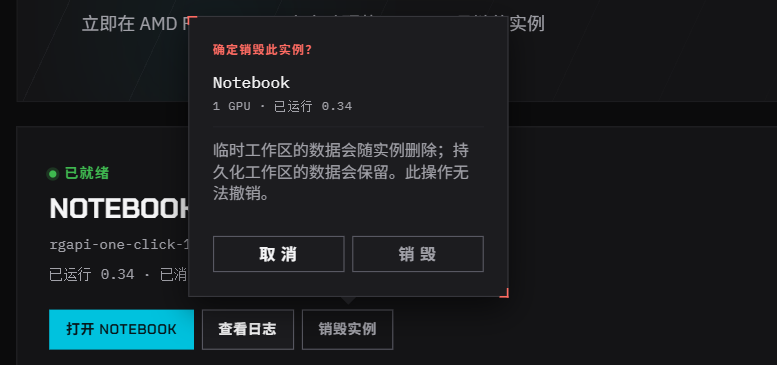

实例只要在运行，不管有没有在用，都会消耗积分。用完请及时销毁。

## 在首页销毁

1. 打开 **首页**，实例卡片上显示着正在运行的实例。
2. 点 **销毁实例**。
3. 确认框会显示实例名称、GPU 数量和已运行时长，并提醒你临时工作区的数据会被删除、持久化工作区的数据会保留。确认是要销毁的实例后，点 **销毁**。

卡片会显示 **正在销毁实例**。销毁完成后，启动表单重新出现，积分停止消耗。

不在持久化 `/workspace` 里的内容，如果还需要，请先保存，见[保存数据](/radeon-cloud-docs/zh-cn/guides/storage/)。

销毁通常几秒钟就能完成。

## 在 JupyterLab 里销毁

JupyterLab 右上角有一个 **Delete instance** 按钮。点击后，在确认框里点 **Destroy**。确认框里同样会提醒临时数据和持久化数据的区别。

销毁后 JupyterLab 标签页不会自动关闭，但已经无法使用，直接关掉即可。**首页** 会显示没有正在运行的实例。

## 销毁耗时过长

如果卡片显示 **销毁耗时超出预期。请刷新页面或联系支持。**，先刷新页面。几分钟后实例仍然存在，请把时间和实例名称发到 [member-service@mail.developer.amd.com.cn](mailto:member-service@mail.developer.amd.com.cn)。

## 实例会被自动停止的情况

实例达到最长运行时长、长时间没有活动，或者积分用完时，平台也会停止它。不要依赖这些限制替你关闭实例：之前消耗的积分不会退回，被中途打断的任务也会丢失尚未保存的结果。

## 退出登录不会停止实例

退出控制台、关闭浏览器或退出 CLI 登录，实例都会继续运行。

## 用 CLI 或 API 销毁

- CLI：`rcc instance delete --yes`，见[管理 GPU 实例](/radeon-cloud-docs/zh-cn/cli/instances/)。
- API：见[实例](/radeon-cloud-docs/zh-cn/api/instances/#销毁实例)。
