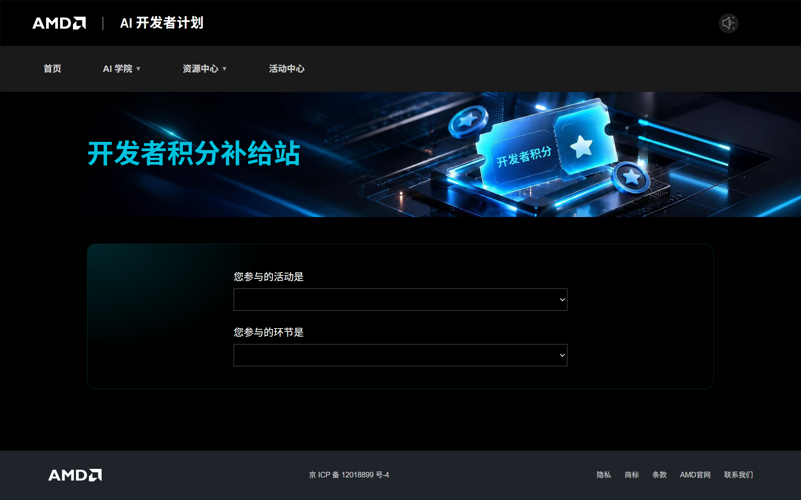
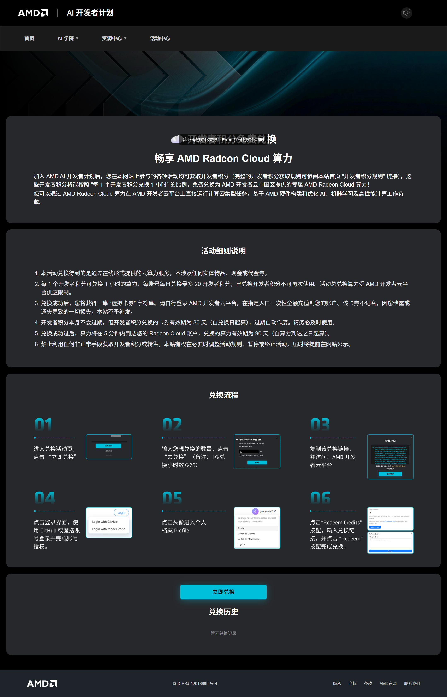

[AMD AI 开发者计划](https://developer.amd.com.cn/) 里的开发者积分，用来换成 GPU 积分。中国站用这个账号登录。全球站也可以用 **使用 AMD Developer Program 登录**，或之后在 **设置** 里连接。无论哪个站点，都是先在计划网站上把开发者积分换成优惠码，再到你要充值的 Radeon Cloud 站点点 **兑换积分** 粘贴。见[登录](/radeon-cloud-docs/zh-cn/guides/login/)。

计划免费加入，没有 AMD 硬件也可以加入。登录后，计划首页会显示你的等级和开发者积分余额。

## 开发者积分怎么换成 Radeon Cloud 积分

| 你手里有 | 去哪里 | 得到 |
|---|---|---|
| 活动发的积分码，形如 `DP-XXXX-XXXX-XXXX` | [开发者积分补给站](https://developer.amd.com.cn/points/devpoints) | 开发者积分 |
| 开发者积分 | [兑取算力](https://developer.amd.com.cn/points/redeem) | 一长串优惠码 |
| 这串优惠码 | 中国站或全球站 **积分与用量** → **兑换积分** | Radeon Cloud 积分 |

## 注册和登录

1. 打开 [developer.amd.com.cn](https://developer.amd.com.cn/)。新用户点 **免费注册**，已有账号点 **登录**。
2. 登录页有两个页签：
   - **验证码登录**：填手机号或邮箱，点 **发送验证码**，再填收到的验证码。发送前可能要先拖动滑块完成验证。验证码发出后按钮会倒计时，倒计时结束前不能重新发送。
   - **密码登录**：适用于已经设置过密码的账号。

   表单下方还可以用魔搭、CSDN 或 GitHub 账号登录。在登录页点 **注册账号** 也能注册新账号。
3. 打开 [developer.amd.com.cn/radeon](https://developer.amd.com.cn/radeon/)。此时中国站已经是登录状态，右上角会显示你的名字。

在[全球站](https://radeon-global.anruicloud.com/)选 **使用 AMD Developer Program 登录**；如果已经用邮箱登录，打开 **设置**，点 **连接 AMD Developer Program**。连接走的是同一个计划，并会要求验证找回邮箱。

按计划的说明，新成员默认有 100 开发者积分。完整规则以计划的[介绍页](https://developer.amd.com.cn/developer-program-intro)为准。本文和介绍页不一致时，以介绍页为准。

## 获得更多开发者积分

在计划网站上学习课程、参加活动都能获得开发者积分。各项活动给多少，可以在首页点 **升级规则** 查看。

参加活动还有两种获得开发者积分的方式，首页 **开发者积分补给站** 里有说明：

- 申报活动参与记录，审核通过后开发者积分自动到账。
- 兑换活动发放的积分码。

兑换积分码：

1. 打开 [points/devpoints](https://developer.amd.com.cn/points/devpoints)（**开发者积分补给站**）。
2. 在 **您参与的活动是** 和 **您参与的环节是** 里选好活动和环节。
3. 在 `DP-XXXX-XXXX-XXXX` 输入框里填兑换码。
4. 勾选 **我同意遵守《开发者积分兑换条款细则》**，点 **兑换**。

每个兑换码只能用一次，兑换后不能撤销。兑换码有有效期，过期不补发。兑换码只限本人使用，不能转让或出售。

## 用开发者积分换优惠码

打开 [points/redeem](https://developer.amd.com.cn/points/redeem)（**开发者积分免费兑换**）。页面上写明的规则：

- 1 个开发者积分换 1 小时算力（1 积分）。页面写的是 AMD 开发者云中国区；拿到优惠码后，在你要充值的中国站或全球站控制台兑换。
- 每个账号每天最多兑换 20 个开发者积分，所以单次可以换 1 到 20 小时。
- 开发者积分兑换后即扣除，没用掉的不会过期。
- 兑换得到的是一长串优惠码，不是 `DP-` 积分码。
- 优惠码自兑换之日起 30 天内有效。
- 优惠码丢失或泄露不补发。控制台只接受属于当前登录账号的优惠码。
- 页面写明：兑换后 5 分钟内积分到账，到账后 90 天内有效。

页面上 **兑换流程** 的六张图是中国站经典版 **Profile**。下面的步骤同时覆盖两个站点和新控制台。

步骤：

1. 点 **立即兑换**。
2. 输入要兑换的小时数，点 **去兑换**。
3. 复制整串优惠码。

如果弹出 **请您先完善个人信息才能领取**，先把计划里的个人资料填完再回来，不要空券去控制台粘贴。

## 在 Radeon Cloud 兑换优惠码

兑取算力在开发者计划网站上，中国站和全球站控制台里都没有这个按钮。两个控制台只有 **兑换积分**，用来粘贴已经拿到的优惠码。

### 中国站

1. 打开 [developer.amd.com.cn/radeon](https://developer.amd.com.cn/radeon/)，点右上角的账号，选 **积分与用量**。
2. 点 **兑换积分**。
3. 在 **兑换积分** 对话框里粘贴整串优惠码，点 **兑换**。输入框里的示例是 `RDN-XXXX-XXXX-XXXX`，但开发者计划给的是你刚才复制的那一长串字符，请完整粘贴。

要确认中国站已经和开发者计划绑定，打开 **设置**，**AMDAI 账号** 一项应显示 **已绑定**。

### 全球站

1. 打开 [radeon-global.anruicloud.com](https://radeon-global.anruicloud.com/)。用 **使用 AMD Developer Program 登录**，或邮箱登录后在 **设置** 里连接。
2. 点右上角的账号，选 **积分与用量**。
3. 点 **兑换积分**，粘贴整串优惠码，点 **兑换**。

连接成功后，**设置** 里的 **AMD Developer Program** 应显示 **已连接**。

余额会立即更新，见[积分](/radeon-cloud-docs/zh-cn/guides/credits/)。

在经典版界面里，同样的兑换入口在 **Profile → Credits Available → Redeem Credits**。

积分只在兑换它的站点有效。在中国站兑换的积分，全球站看不到，反过来也一样。

## 兑换失败怎么办

失败一般是下面几种原因之一：

- 优惠码只复制了一部分。
- 优惠码已经超过 30 天。
- 这张优惠码已经兑换过。
- 兑到了不是你想充值的站点。积分兑换后不能在站点之间转移。
- 在全球站，账号还没连接到发出这张券的开发者计划，或验证过的找回邮箱对不上。
- 计划网站提示 **请您先完善个人信息才能领取**，还没有拿到优惠码。

都排除了还是不行，就发邮件到 [member-service@mail.developer.amd.com.cn](mailto:member-service@mail.developer.amd.com.cn)。写明用的是哪个站点、出问题的时间，以及页面上的原始提示。优惠码和现金一样：只在这封邮件里提供，不要发到群聊或公开的 issue 里。也可以点计划首页或中国站控制台底部的 **去提问**，打开[反馈表](https://developer.amd.com.cn/feedbackform)提交问题。
