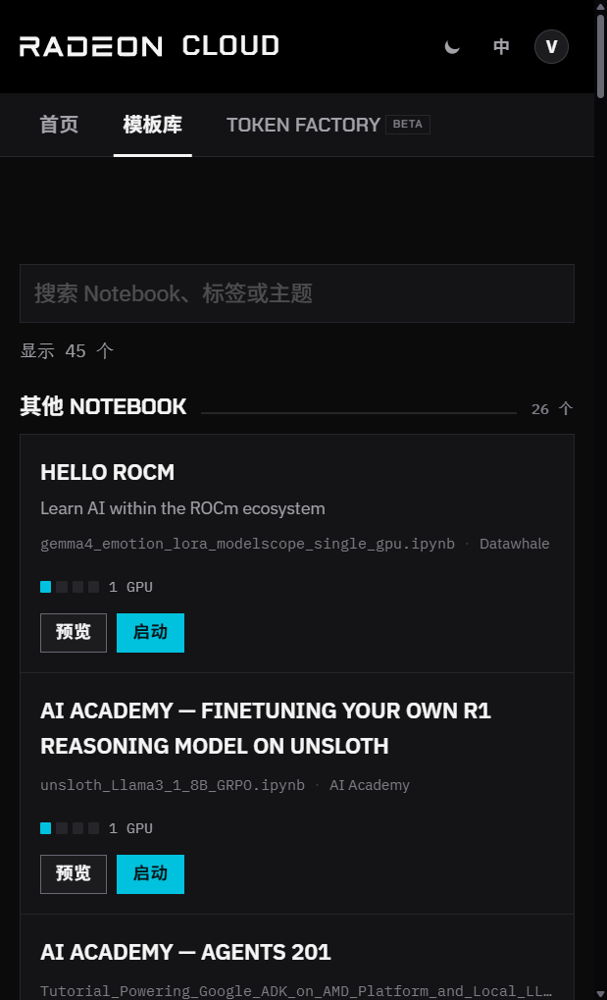

**模板库** 收录了可以直接在 Radeon Cloud 上运行的 Notebook，包括教程、工作坊材料和演示。启动其中一个，就会得到一台配好所需环境的实例。

## 查找 Notebook

在控制台打开 **模板库**。Notebook 按分类分组，比如工作坊、课程和大模型演示。每张卡片上有 Notebook 的标题和说明、会打开的 Notebook 文件、标签，以及需要的 GPU 数量。

可以按标题、标签或主题搜索，搜索框旁边会显示匹配的数量。点 **预览** 可以在启动前先阅读 Notebook 的内容。

## 启动

1. 确认没有正在运行的实例。有实例在运行时，**启动** 按钮不可用。
2. 在 Notebook 上点 **启动**。
3. 和普通实例一样查看启动进度，见[启动实例](/radeon-cloud-docs/zh-cn/guides/launch/)。
4. 实例就绪后，点 **打开 Notebook**。

实例使用 Notebook 作者设定的镜像和规格；作者没有指定规格时，默认 1 GPU。和所有实例一样，SSH 默认开启，运行期间同样消耗积分，用完请及时销毁。
