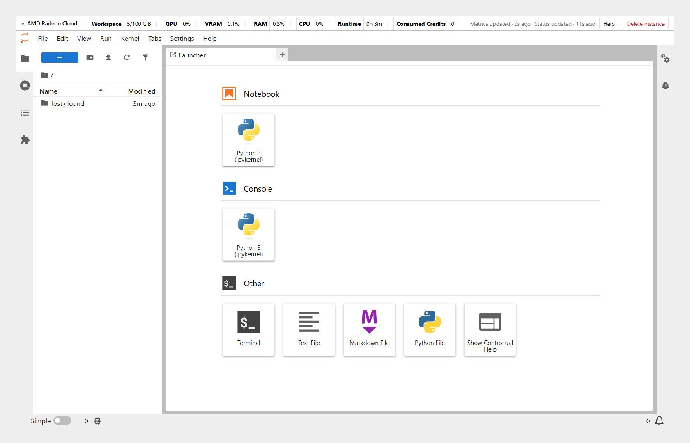

Notebook 实例运行的是 JupyterLab：一个在浏览器里使用的开发环境，包含 Notebook、终端和文件浏览器。

## 打开 JupyterLab

启动弹窗显示 **实例已就绪** 时，或者在 **首页** 的实例卡片上，点 **打开 Notebook**。JupyterLab 会在新标签页打开，默认位于 `/workspace` 目录。

右上角有两个 Radeon Cloud 提供的按钮：**Help**，以及用于销毁实例的 **Delete instance**，见[销毁实例](/radeon-cloud-docs/zh-cn/guides/destroy/#在-jupyterlab-里销毁)。

顶部的状态栏可以快速查看实例情况：**Workspace**（工作区用量）、**GPU**、**VRAM**（显存）、**RAM**、**CPU**、**Runtime**（运行时长）和 **Consumed Credits**（已消耗积分）。



## 检查 GPU

打开终端（**File → New → Terminal**，或者 Launcher 里的 **Terminal**），运行：

```bash
rocm-smi
```

它会列出实例挂载的 Radeon GPU，以及显存占用和温度。确认 PyTorch 能使用 GPU：

```bash
python -c "import torch; print(torch.cuda.is_available(), torch.cuda.device_count())"
```

ROCm 版 PyTorch 沿用 `torch.cuda` 这套接口名称，输出 `True` 就说明 ROCm 工作正常。

查看显存大小：

```bash
rocm-smi --showmeminfo vram
```

## CPU 和内存限制

CPU 和内存上限由启动时选的规格决定，例如 16 核、55 GB。`nproc` 这类命令显示的是整台节点的核数，而不是你的上限。工具需要设置线程数或 worker 数时，请按规格里的核数来设，不要按 `nproc` 的结果。

## 管理文件

- 左侧的文件浏览器显示实例里的文件。把文件拖进去，或者用上传按钮，就能导入 Notebook 和数据。
- 要下载文件，右键文件选 **Download**。
- 需要保留的内容请放在 `/workspace` 下，并用持久化存储启动实例，见[保存数据](/radeon-cloud-docs/zh-cn/guides/storage/)。

## 运行长任务

在 Notebook 单元格里启动的任务，会随内核停止而停止。长时间运行的任务，请在终端里启动，并把输出写到文件：

```bash
nohup python train.py > /workspace/train.log 2>&1 &
tail -f /workspace/train.log
```

积分用完或超过 **超时回收** 时长时，实例会被删除，所以请边跑边把检查点保存到持久化的 `/workspace`。

## 访问 Web 应用

要让实例里运行的 Web 服务（比如 Gradio 应用，或者正在开发的 API）能从公网访问，见[对外暴露服务](/radeon-cloud-docs/zh-cn/guides/tunnel/)。
