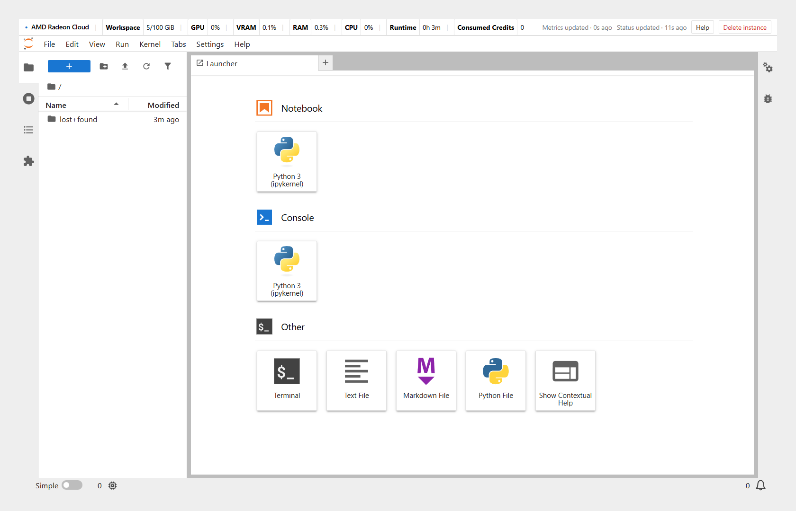

选 **部署类型：Notebook** 启动的实例，运行的是 JupyterLab。JupyterLab 是浏览器里的开发环境，包含 Notebook、终端和文件浏览器。

## 打开 JupyterLab

实例就绪后，启动弹窗或 **首页** 的实例卡片上会出现 **打开 Notebook**。点这个按钮进入 JupyterLab，默认路径是 `/workspace`。

右上角有两个 Radeon Cloud 提供的按钮：**Help**，以及用于销毁实例的 **Delete instance**，见[销毁实例](/radeon-cloud-docs/zh-cn/guides/destroy/#在-jupyterlab-里销毁)。

顶部的状态栏可以快速查看实例情况：**Workspace**（工作区存储用量）、**GPU**、**VRAM**（显存）、**RAM**、**CPU**、**Runtime**（运行时长）和 **Consumed Credits**（已消耗积分）。



## 检查 GPU

打开终端（**File → New → Terminal**，或者 Launcher 里的 **Terminal**），运行：

```bash
rocm-smi
```

它会列出实例挂载的 Radeon GPU，以及显存占用和温度。确认 PyTorch 能使用 GPU：

```bash
python -c "import torch; print(torch.cuda.is_available(), torch.cuda.device_count())"
```

ROCm 版 PyTorch 沿用 `torch.cuda` 这套接口名称，输出 `True` 就说明 ROCm 工作正常。

查看显存大小：

```bash
rocm-smi --showmeminfo vram
```

## CPU 和内存

实例可用的 CPU 和内存，以启动时选择的规格为准。容器内 `nproc`、`free` 等命令反映的是宿主机资源，通常高于该配额。配置线程数、worker 数或其他并行度时，请按规格中的数值设置。

## 管理文件

左侧文件浏览器对应实例文件系统。上传文件：拖放到该面板，或使用上传按钮。下载文件：右键目标文件，选择 **Download**。

实例销毁后仍需保留的数据，须放在 `/workspace`，并在启动时启用持久化存储，见[保存数据](/radeon-cloud-docs/zh-cn/guides/storage/)。

## 单元格运行状态

代码单元格按其最近一次运行结果标记：

- 运行中：黄色背景，❗
- 成功：绿色背景，✅
- 失败：红色背景，❌

标记仅存在于当前浏览器会话，不会写入 Notebook，刷新后消失。该功能需要 JupyterLab 4；镜像中的 JupyterLab 版本较低时不会显示。

## 长时间任务

Notebook 单元格中的进程会随内核停止而结束。长时间任务请在终端中启动，并将输出重定向到文件：

```bash
nohup python train.py > /workspace/train.log 2>&1 &
tail -f /workspace/train.log
```

积分耗尽或到达 **自动销毁** 时间后，实例会被销毁。请将检查点写入 `/workspace`，并使用持久化存储启动实例，见[保存数据](/radeon-cloud-docs/zh-cn/guides/storage/)。

## 从公网访问服务

实例内的 Web 服务默认不能从公网访问。若需为 Gradio 应用或本地 API 分配公网 URL，见[对外暴露服务](/radeon-cloud-docs/zh-cn/guides/tunnel/)。
