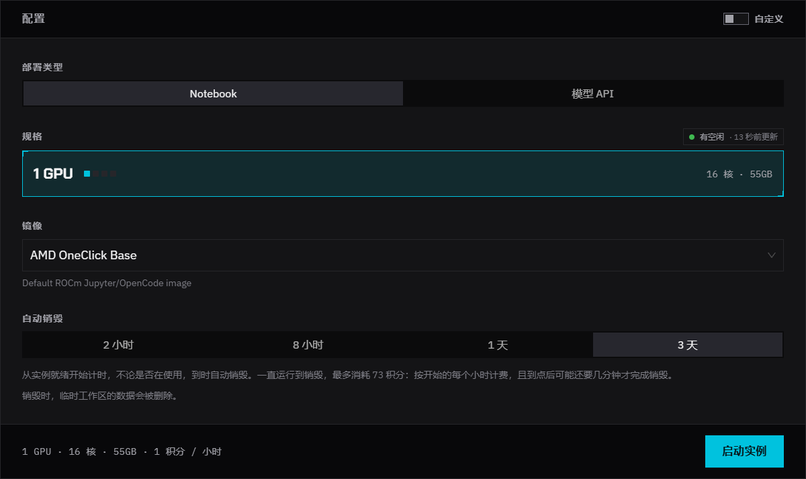
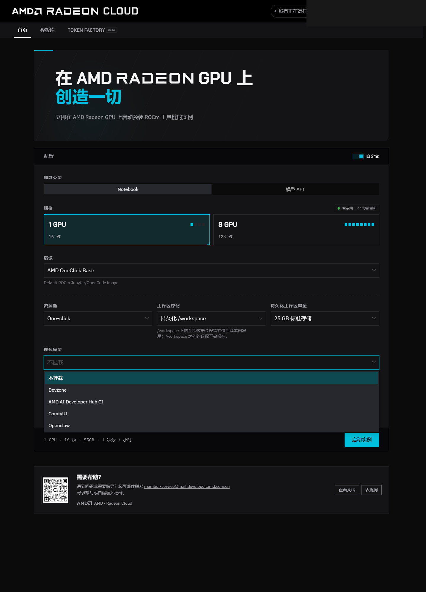
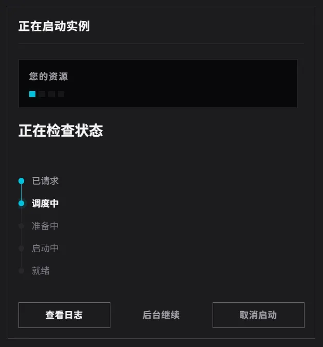
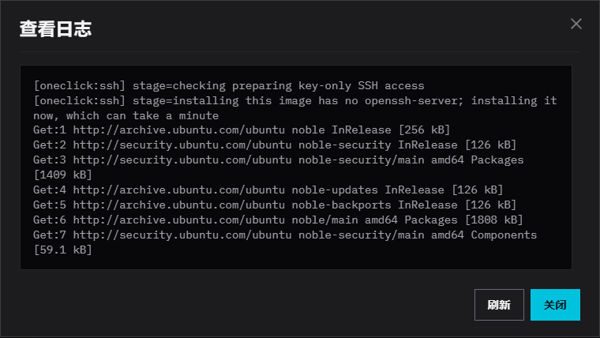
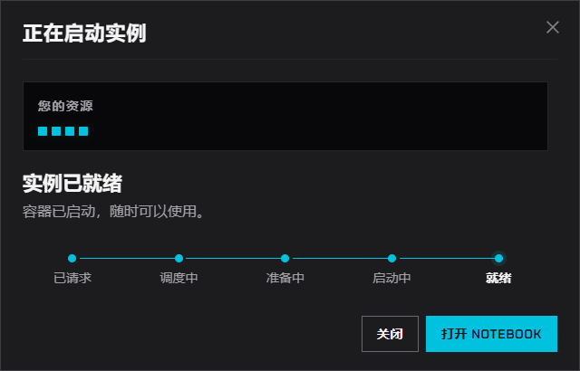
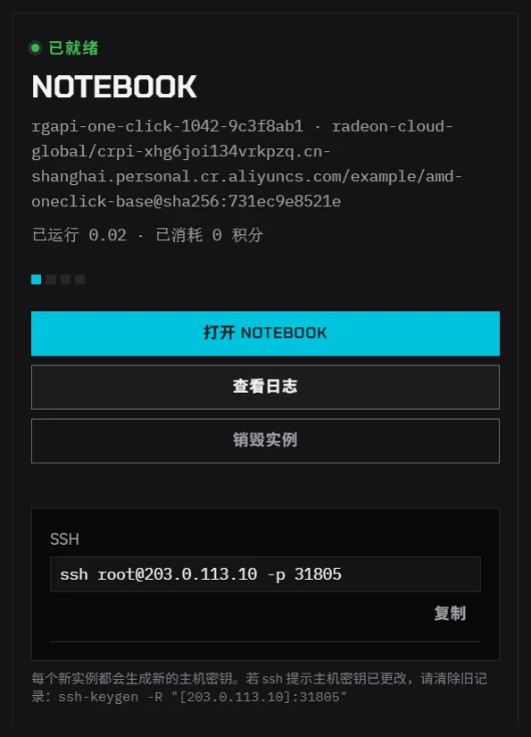
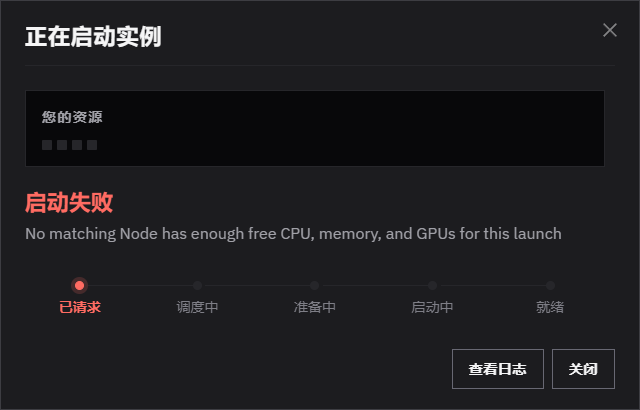

实例在控制台的 **首页** 启动。本页依次介绍启动表单、启动进度弹窗，以及可能遇到的报错。

## 开始之前

- 先登录，见[登录](/radeon-cloud-docs/zh-cn/guides/login/)。
- 确认积分至少够所选规格运行 1 小时，见[积分](/radeon-cloud-docs/zh-cn/guides/credits/)。
- 要用 SSH，先在 **设置** 里添加公钥，见[通过 SSH 连接](/radeon-cloud-docs/zh-cn/guides/ssh/)。
- 销毁仍在运行的实例。每个账号同时只能运行一个实例。

## 用默认配置启动

1. 打开 **首页**。
2. **部署类型** 保持 **Notebook**。
3. **镜像** 保持 **AMD OneClick Base**，或者换成其他镜像，见[选择镜像](/radeon-cloud-docs/zh-cn/guides/images/)。
4. 点 **启动实例**。

**自定义** 关闭时，表单使用你账号可用的最小规格、临时工作区，不挂载模型。按钮上方那一行会显示最终配置，例如 **1 GPU · 16 核 · 55GB · 1 积分 / 小时**。

**规格** 旁边的状态点表示当前资源池是否还有空闲 GPU：**有空闲**、**余量紧张** 或 **已满**。显示 **已满** 时 **启动实例** 仍可点，但这次启动很可能会失败，请稍后再试或换一个资源池。

**自动销毁** 是实例就绪后最长能运行多久，不论你是否在使用。在表单上选择时长，例如 **2 小时**、**8 小时**、**1 天** 或 **3 天**。最长一档取决于资源池。表单还会估算一直运行到销毁最多消耗多少积分。

实例运行后可以 **延长** 一次销毁时间，见[实例会被自动停止的情况](/radeon-cloud-docs/zh-cn/guides/instances/#实例会被自动停止的情况)。

## 自定义启动配置

打开 **自定义**，可以设置其余选项。

| 字段 | 怎么选 |
|---|---|
| **规格** | 选择 GPU 数量。同一 GPU 数量有多种内存时，会出现 **内存** 一行，每个选项都标有每小时消耗的积分。选能装下你的模型的最小规格。 |
| **镜像** | 默认镜像适合大多数场景。 |
| **资源池** | 大多数账号只有一个资源池。如果你有多个，规格旁显示 **已满** 或启动因资源不足失败时，可以换一个试试。 |
| **工作区存储** | **临时工作区（本地高速存储）** 速度快，随实例删除；**持久化 /workspace** 会保留 `/workspace` 下的全部内容，供下一次启动实例继续使用。选持久化后默认是 **25 GB 标准存储**；表单出现 **100 GB 大容量存储** 才表示你的账号能选。见[保存数据](/radeon-cloud-docs/zh-cn/guides/storage/)。 |
| **挂载模型** | 把平台准备好的模型以只读方式挂载进实例，省去下载。下拉里目前是 **ComfyUI**、**Openclaw**、**Devzone**，挂载路径见[挂载的模型](/radeon-cloud-docs/zh-cn/guides/storage/#挂载的模型)。不需要就保持 **不挂载**。 |

运行中的实例不能修改配置。要换存储或规格，先销毁实例再重新启动。

要部署模型服务，把 **部署类型** 设为 **模型 API**，见[部署模型服务](/radeon-cloud-docs/zh-cn/guides/serve-model/)。

## 查看启动进度

点 **启动实例** 后，首页弹出 **正在启动实例**。弹窗里是这些内容：

| 界面 | 做什么 |
|---|---|
| **已请求**、**调度中**、**准备中**、**启动中**、**就绪** | 顶部的步骤，按这个顺序往前走。 |
| 自动销毁说明 | 写明实例将在什么时候自动销毁。 |
| **查看日志** | 打开 **启动日志**：上面是事件，下面是容器输出。还没分到节点、镜像没拉完时，容器输出是空的。 |
| **后台继续** | 关掉弹窗，启动继续。就绪后 **首页** 出现实例卡片。 |
| **取消启动** | 停止这次启动。 |

有空闲节点时，实例通常一分钟内就能就绪。某个镜像在一个节点上第一次启动时会慢一些，因为节点要先下载镜像。

## 启动完成后

弹窗显示 **实例已就绪**。点 **打开 Notebook**，会在新标签页打开 [JupyterLab](/radeon-cloud-docs/zh-cn/guides/jupyterlab/)。

此时 **首页** 显示实例卡片：

- **打开 Notebook**：打开 JupyterLab。
- **查看日志**：查看启动事件和容器输出。
- **销毁实例**：删除实例，见[销毁实例](/radeon-cloud-docs/zh-cn/guides/destroy/)。
- 卡片上还会显示镜像、已运行时长、已消耗的积分，以及 **将于 … 自动销毁**。临近销毁时可点 **延长**，每个实例只能延长一次，且不超过启动时选的时长。
- SSH 准备好之后会显示 SSH 命令，见[通过 SSH 连接](/radeon-cloud-docs/zh-cn/guides/ssh/)。

## 启动失败时

| 提示 | 含义 | 处理方法 |
|---|---|---|
| **No matching Node has enough free CPU, memory, and GPUs for this launch** | 所选资源池里的节点都满了。 | 如果规格旁已经显示 **已满**，请稍后再点 **重试**。否则打开 **自定义**，有其他 **资源池** 就换一个，或选更小的规格。如果账号只有一个资源池且反复失败，请发邮件到 [member-service@mail.developer.amd.com.cn](mailto:member-service@mail.developer.amd.com.cn)。 |
| **等待空闲 GPU** | 暂时没有节点有空位，启动仍在排队。 | 继续等待，或者取消后换更小的规格或其他资源池。 |
| **镜像拉取失败** | 节点没能下载镜像。 | 重试一次。仍然失败就换一个镜像，并把镜像名称告诉开发团队。 |
| **您已有一个正在运行的实例。** | 账号下已经有实例在运行。 | 先销毁它。 |
| **资源目录不可用，请重试。** | 控制台没能加载你账号可用的规格和资源池。 | 刷新页面。 |

启动失败不会创建实例，也不会消耗积分。

更多情况见[疑难排查](/radeon-cloud-docs/zh-cn/resources/troubleshooting/)。

## 在终端里启动

`rcc instance create` 可以在命令行启动同样的实例，见[管理 GPU 实例](/radeon-cloud-docs/zh-cn/cli/instances/)。
