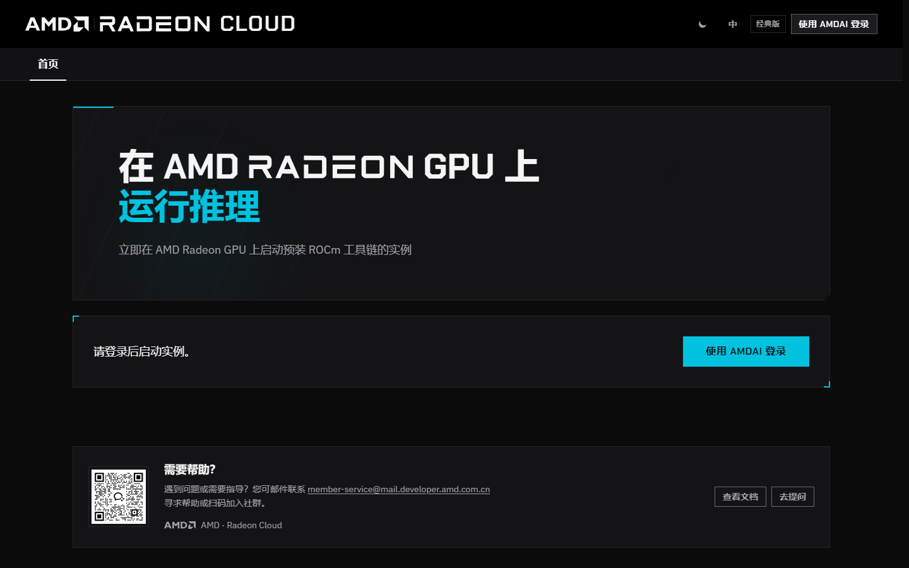
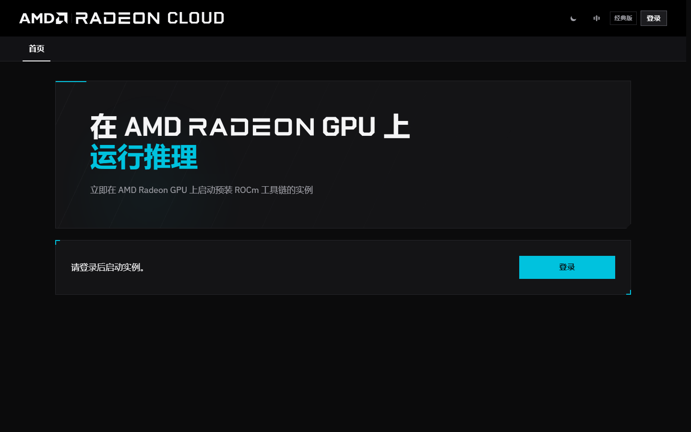
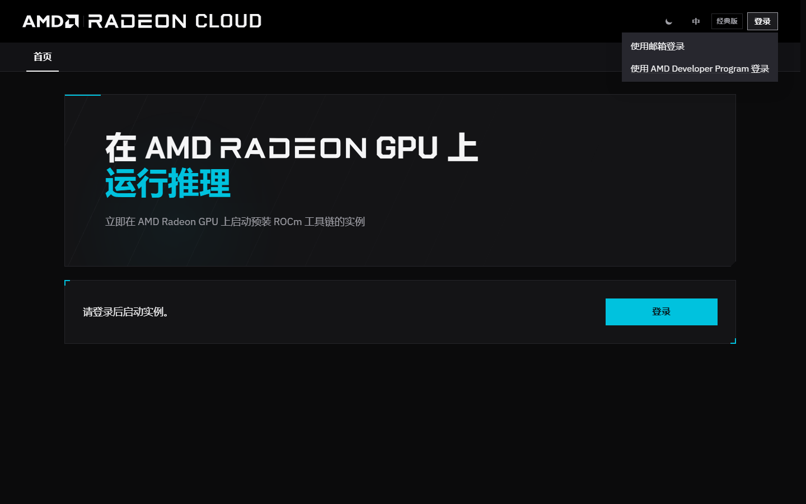
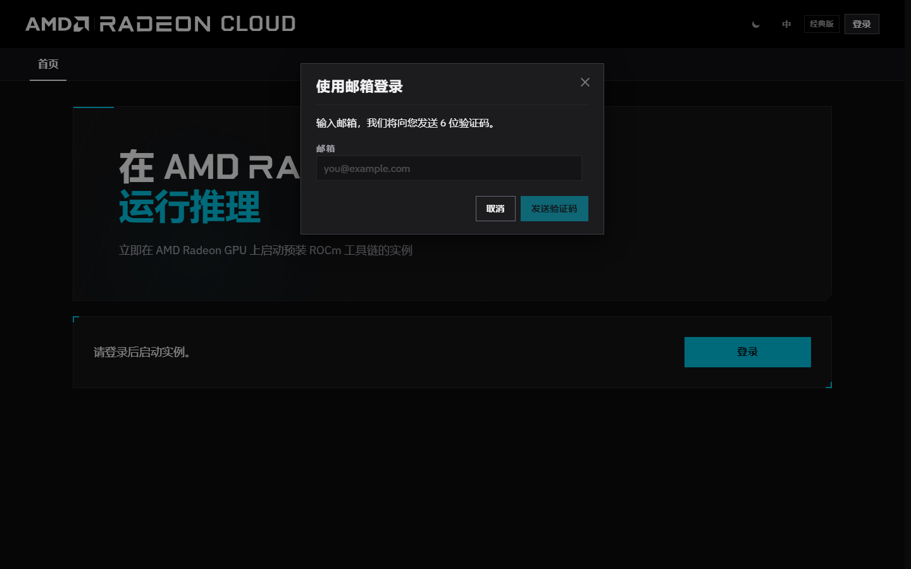
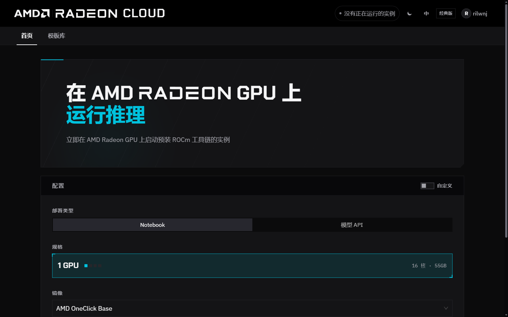

[中国站和全球站](/radeon-cloud-docs/zh-cn/introduction/#中国站和全球站)的账号互不相通，登录方式也不同。按你所在的地区选择。

本文档以新版控制台为准。未登录时，导航里只有 **首页**。登录后会出现 **模板库**。**Token Factory** 只在中国站出现。

## 中国站

中国站使用 [AMD AI 开发者计划](/radeon-cloud-docs/zh-cn/guides/developer-program/) 的账号。可以先在 [developer.amd.com.cn](https://developer.amd.com.cn/) 登录，也可以打开 [developer.amd.com.cn/radeon](https://developer.amd.com.cn/radeon/) 再登录。两种方式进入的是同一个开发者计划登录页。

新浏览器常常先打开经典版模板库。可以继续用经典版，也可以点右下角的 **Switch to the new design** 切到新版，见[经典版界面](/radeon-cloud-docs/zh-cn/resources/classic-ui/)。

### 从经典版模板库登录

点右上角的 **Login**。

### 从新版控制台登录

切到新版后，**首页** 会提示先登录。点 **使用 AMDAI 登录**，页头和面板上的按钮都可以。

### 开发者计划登录页

登录页有两个页签：

- **验证码登录**：填手机号或邮箱，点 **发送验证码**，再填收到的验证码。发送前可能要先拖动滑块完成验证。验证码发出后按钮会倒计时，倒计时结束前不能重新发送。
- **密码登录**：适用于已经设置过密码的账号。

表单下方还可以用魔搭、CSDN 或 GitHub 账号登录。

还没有账号的话，在登录页点 **注册账号**，或者在[计划首页](https://developer.amd.com.cn/)点 **免费注册**。

登录开发者计划后，中国站也就登录好了，控制台右上角会显示你的名字。用来兑换 Radeon Cloud [积分](/radeon-cloud-docs/zh-cn/guides/credits/)的开发者积分也存在这个账号里。

## 全球站

1. 打开 [radeon-global.anruicloud.com](https://radeon-global.anruicloud.com/)，进入 **首页**。
2. 点右上角的 **登录**，或点 **请登录后启动实例。** 旁边的 **登录**。

3. 选 **使用邮箱登录** 或 **使用 AMD Developer Program 登录**。

如果选了 **使用邮箱登录**，在 **邮箱** 里填地址，再点 **发送验证码**。验证码几分钟后失效；没收到就等冷却结束再重发一次。

页头还有 **经典版**（切回经典版界面），以及语言（**EN** / **中**）和外观切换。

## 登录之后

控制台仍在 **首页**，在这里启动实例。没有实例时，页头会显示 **没有正在运行的实例**。登录后导航里会出现 **模板库**。**Token Factory** 只在中国站出现；全球站目前没有。

点右上角的账号，可以看到：

- 积分余额
- **积分与用量**：积分和兑换优惠码。中国站这个页面还会显示 Token Factory 用量，见[积分](/radeon-cloud-docs/zh-cn/guides/credits/)
- **设置**：SSH 密钥、语言、外观、绑定 AMD Developer Program 账号，以及切换到经典版界面
- **退出登录**

如果你的控制台里看到的是 **Profile** 页面，说明你在用经典版界面，见[经典版界面](/radeon-cloud-docs/zh-cn/resources/classic-ui/)。

## 设置

从账号菜单打开 **设置**。

- **SSH 密钥**：添加以后启动的实例能用的公钥，见[用 SSH 连接](/radeon-cloud-docs/zh-cn/guides/ssh/)。
- **语言**：**EN** 或 **中**。页头的 **EN** / **中** 作用相同。
- **外观**：浅色或深色主题。
- **AMD Developer Program**：在全球站，如果用该账号登录，可以在这里绑定。在中国站，**AMDAI 账号** 应显示 **已绑定**。
- **界面**：**使用经典版** 会切回经典版控制台，见[经典版界面](/radeon-cloud-docs/zh-cn/resources/classic-ui/)。

## 如果账号需要审核

部分新账号需要通过审核后才能使用。审核完成前，登录后看到的是审核页面而不是控制台，不能启动实例，也拿不到 API Key。账号通过审核后即可正常使用。

如果审核时间比预期长，请把账号邮箱发到 [member-service@mail.developer.amd.com.cn](mailto:member-service@mail.developer.amd.com.cn)。
