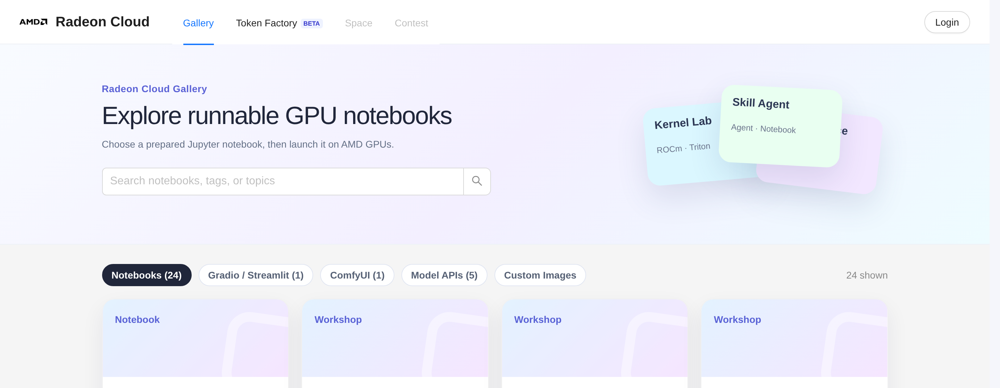
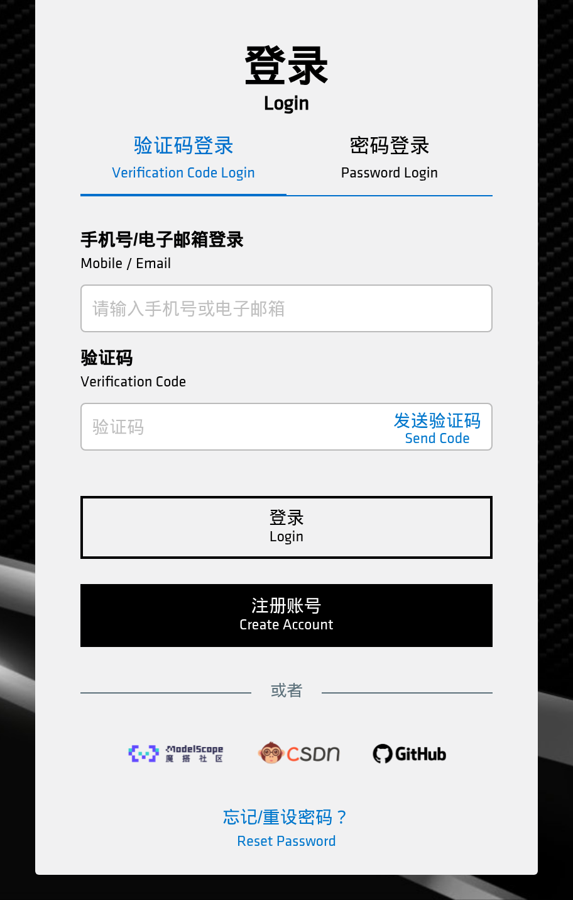
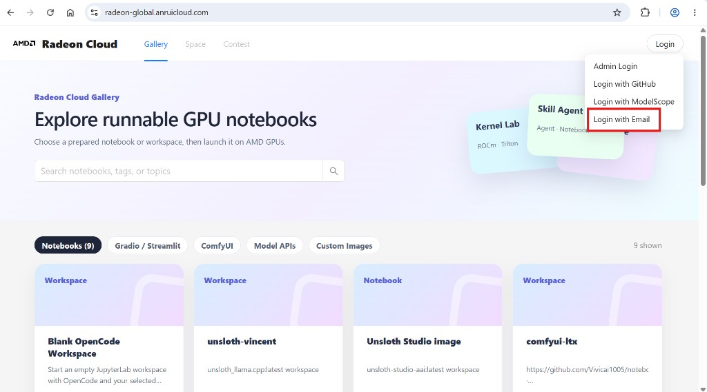

[中国站和全球站](/radeon-cloud-docs/zh-cn/introduction/#中国站和全球站)的账号互不相通，登录方式也不同。按你所在的地区选择。

## 中国站

中国站使用 [AMD AI 开发者计划](/radeon-cloud-docs/zh-cn/guides/developer-program/) 的账号。可以先在 [developer.amd.com.cn](https://developer.amd.com.cn/) 登录，也可以在 [developer.amd.com.cn/radeon](https://developer.amd.com.cn/radeon/) 右上角点 **Login**。两种方式进入的是同一个开发者计划登录页。

登录页有两个页签：

- **验证码登录**：填手机号或邮箱，点 **发送验证码**，再填收到的验证码。发送前可能要先拖动滑块完成验证。验证码发出后按钮会倒计时，倒计时结束前不能重新发送。
- **密码登录**：适用于已经设置过密码的账号。

表单下方还可以用魔搭、CSDN 或 GitHub 账号登录。

还没有账号的话，在登录页点 **注册账号**，或者在[计划首页](https://developer.amd.com.cn/)点 **免费注册**。

登录开发者计划后，中国站也就登录好了，控制台右上角会显示你的名字。用来兑换 Radeon Cloud [积分](/radeon-cloud-docs/zh-cn/guides/credits/)的开发者积分也存在这个账号里。

## 全球站

打开 [radeon-global.anruicloud.com](https://radeon-global.anruicloud.com/)，点右上角的 **Login**，选 **Login with Email**。

填邮箱地址和收到的 6 位验证码。验证码几分钟后失效；没收到就等冷却结束再重发一次。

## 登录之后

控制台登录后进入 **首页**，在这里启动实例。顶部的标签页可以切换到 **模板库** 和 **Token Factory**。

点右上角的账号，可以看到：

- 积分余额
- **积分与用量**：积分、兑换优惠码、模型 API 用量，见[积分](/radeon-cloud-docs/zh-cn/guides/credits/)
- **设置**：SSH 密钥、语言、外观、AMDAI 账号绑定，以及切换到经典版界面
- **退出登录**

页头还有切换语言（**EN** / **中**）和浅色、深色主题的按钮。

如果你的控制台里看到的是 **Profile** 页面，说明你在用经典版界面，见[经典版界面](/radeon-cloud-docs/zh-cn/resources/classic-ui/)。

## 如果账号需要审核

有些账号在能启动实例之前要先过审核。看到相关提示的话，你仍然可以浏览控制台、使用[免费的共享模型 API](/radeon-cloud-docs/zh-cn/guides/shared-models/) —— 审核通过后就能启动 GPU 实例了。
