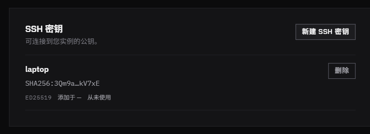

通过 SSH，你可以在自己的终端和编辑器里使用实例。请在启动实例**之前**到设置里添加公钥：没有公钥时启动的实例不会开启 SSH，之后再添加公钥也不会生效，需要重新启动实例。保存过的公钥会用于之后每次启动。

## 添加公钥

1. 如果还没有密钥对，先生成一对。macOS、Linux 和 Windows PowerShell 都可以运行：

   ```bash
   ssh-keygen -t ed25519 -C "laptop"
   ```

   私钥保存在 `~/.ssh/id_ed25519`，公钥保存在 `~/.ssh/id_ed25519.pub`。

2. 打印公钥并复制：

   ```bash
   cat ~/.ssh/id_ed25519.pub
   ```

3. 在控制台打开 **设置**，点 **新建 SSH 密钥**。
4. **名称** 填这台电脑的名字，**密钥** 里粘贴公钥，然后点对话框里的 **新建 SSH 密钥**。

添加后，列表里会显示密钥的名称和指纹。每台电脑可以各添加一把，最多 10 把。



:::danger[只粘贴 .pub 文件]
公钥以 `ssh-ed25519` 或 `ssh-rsa` 开头，来自扩展名为 `.pub` 的文件。不要粘贴私钥。
:::

密钥只对添加之后启动的实例生效。已经在运行的实例，仍使用它启动时的那组密钥。

## 等待 SSH 就绪

SSH 会比实例稍晚一点就绪：镜像里没有 SSH 服务端时，平台会在启动后自动安装并配置。配置期间，实例卡片显示 **正在配置 SSH — 请稍后再连接**，此时 JupyterLab 已经可以使用。

SSH 就绪后，卡片上会显示 **SSH 已就绪** 和 SSH 命令。

## 连接

点实例卡片上命令旁边的 **复制**，在终端里运行。命令格式如下：

```bash
ssh root@<host> -p <port>
```

登录用户是 `root`。第一次连接时输入 `yes` 接受主机密钥。

如果用的不是默认密钥，加上 `-i` 和私钥路径。

### 提示 “Remote host identification has changed”

新实例可能沿用之前实例的主机和端口，但主机密钥是新的。如果 `ssh` 提示主机密钥已更改，用实例卡片上给出的命令删掉旧记录，再重新连接：

```bash
ssh-keygen -R "[<host>]:<port>"
```

## 拷贝文件

用 `scp` 或 `rsync`，主机、端口和用户与 SSH 命令相同，例如：

```bash
scp -P <port> results.tar.gz root@<host>:/workspace/
```

## 用 CLI 连接

`rcc instance ssh` 不用复制命令就能直接连接，见[管理 GPU 实例](/radeon-cloud-docs/zh-cn/cli/instances/)。

## SSH 配置失败

镜像里没有 SSH 服务端时，平台会在实例启动后现装一个。网络慢时，下载可能超时，卡片就会显示 **SSH 配置失败**。JupyterLab 不受影响，SSH 命令仍然显示在卡片上。

请看卡片上的提示，按下面的情况处理：

| 提示的意思 | 怎么办 |
|---|---|
| 下载或安装失败、连不上软件源、镜像里没有 SSH 服务端 | [自己安装 SSH](#自己安装-ssh)；或者过一会儿重新启动实例；或者换一个自带 SSH 服务端的镜像（见下面的提示） |
| 镜像的操作系统不支持、根文件系统只读、不是以 `root` 运行 | 这几种自己装也没用，换一个镜像启动 |
| 配置失败，或 SSH 服务端启动失败 | 销毁实例后重新启动；如果再次出现，请[联系支持](/radeon-cloud-docs/zh-cn/resources/troubleshooting/#仍然无法解决) |

:::tip[自带 SSH 服务端的镜像]
下面这些官方镜像已经自带，启动时不需要安装：Base、PyTorch · Stable、PyTorch · Latest、vLLM · Stable、vLLM · Latest、SGLang 和 ComfyUI。
:::

### 自己安装 SSH

在 JupyterLab 里打开一个终端，以 `root` 运行下面的命令，`root` 是这些实例上的默认用户：

```bash
apt-get update
apt-get install -y --no-install-recommends openssh-server
mkdir -p /run/sshd /root/.ssh && chmod 700 /root/.ssh
echo '<your public key>' >> /root/.ssh/authorized_keys
chmod 600 /root/.ssh/authorized_keys
ssh-keygen -A
/usr/sbin/sshd -o PasswordAuthentication=no -o AllowTcpForwarding=no
```

把 `<your public key>` 换成 `.pub` 文件里的整行内容，就是你在 **设置** 里添加的那一行。RHEL 系和 Fedora 上，用 `dnf install -y openssh-server` 代替前两行；Alpine 上用 `apk add --no-cache openssh`。如果下载很慢，等一会儿再运行。

然后按[连接](#连接)里的方法，用卡片上的 SSH 命令连接。

:::note[和自动配置的区别]
- 你启动的 SSH 服务端只在容器运行期间有效。实例重启后，需要重新执行这些步骤。
- 卡片会一直显示 **SSH 配置失败**，因为它只反映平台自己的配置结果。直接复制卡片上的 SSH 命令来连接即可。
:::

## SSH 的限制

- **不支持端口转发和隧道。** `ssh -L`、`ssh -R`、`ssh -D` 和跳板机都用不了。请直接在控制台打开 JupyterLab，不要通过 SSH 转发它的端口。
- **依赖 SSH 隧道的工具无法连接，** 例如 VS Code、Cursor 和 JetBrains 的远程开发功能。普通终端会话、`scp`、`sftp`、`rsync` 以及 `rcc instance ssh` 可以正常使用。
- **只能用密钥登录。** 不支持密码登录，登录用户是 `root`。
