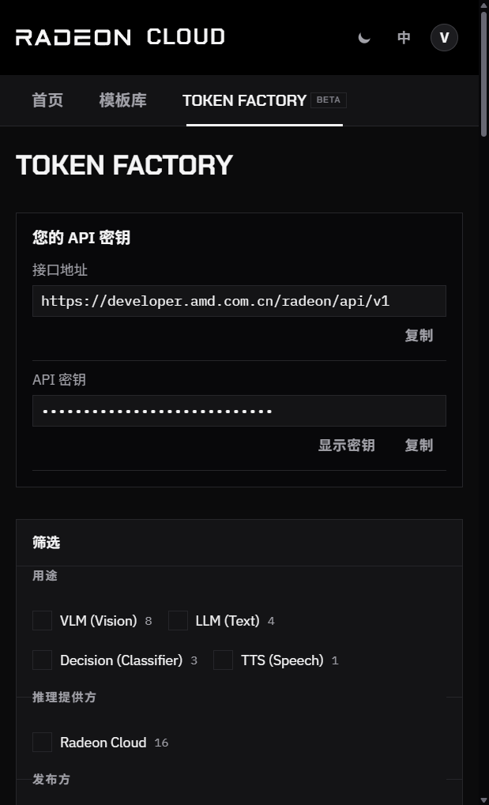

Token Factory 在 Radeon GPU 上托管了一批模型，通过兼容 OpenAI 的接口提供服务。不需要启动实例，也不消耗积分，复制 API Key 就能发请求。`curl`、`openai` SDK、LangChain、Cherry Studio 等 OpenAI 客户端，只要换掉 base URL 和 API Key 就能使用。

Token Factory 只在中国站提供。提供哪些模型由平台决定，会不定期调整。要运行列表里没有的模型，或者想自己设置 vLLM 参数，请[在 GPU 实例上部署模型服务](/radeon-cloud-docs/zh-cn/guides/serve-model/)。

## 获取 API Key

1. 登录控制台，打开 **Token Factory**。
2. 顶部的 **您的 API 密钥** 卡片显示 **接口地址** 和 **API 密钥**。密钥默认隐藏，点 **显示密钥** 查看，或点 **复制** 直接复制。



API Key 以 `rc-` 开头，可以调用 Token Factory 里的所有模型。请妥善保管：拿到 Key 的人可以用掉你的每日用量。轮换 Key 的方法见[认证](/radeon-cloud-docs/zh-cn/api/authentication/)。

## 选择模型

Token Factory 列出了所有模型，可以按 **用途**、**推理提供方** 或 **发布方** 筛选，也可以按名称搜索。每张卡片会显示模型当前是否繁忙。

点开卡片可以看到模型说明、价格和调用方法，`model` 字段要填的值也在里面。每个模型接受哪些参数，见[模型目录](/radeon-cloud-docs/zh-cn/models/overview/)。

价格以 pts 计，按每百万 token 标注，例如 **0.14 pts / 1M tokens**。按输入字符计费的模型（例如 OmniVoice）标注为 **pts / 1M characters**。pts 只用来计算[每日用量上限](#用量限制)，不是费用，也不是积分。

## 发送请求

```bash
export RADEON_API_KEY=rc-...

curl https://developer.amd.com.cn/radeon/api/v1/chat/completions \
  -H "Authorization: Bearer $RADEON_API_KEY" \
  -H "Content-Type: application/json" \
  -d '{"model":"DeepSeek-V4-Flash","messages":[{"role":"user","content":"你好"}]}'
```

在 Python 里，把 OpenAI SDK 指向同一个 base URL：

```python
from openai import OpenAI

client = OpenAI(base_url="https://developer.amd.com.cn/radeon/api/v1", api_key="rc-...")
response = client.chat.completions.create(
    model="DeepSeek-V4-Flash",
    messages=[{"role": "user", "content": "你好"}],
)
print(response.choices[0].message.content)
```

换模型只要改 `model`。列出你的 API Key 可以调用的模型：

```bash
curl https://developer.amd.com.cn/radeon/api/v1/models \
  -H "Authorization: Bearer $RADEON_API_KEY"
```

Token Factory 也支持 Anthropic 的 Messages API，供 Claude Code 等客户端使用，见 [Messages](/radeon-cloud-docs/zh-cn/api/messages/)。全部接口见 [API 参考](/radeon-cloud-docs/zh-cn/api/overview/#token-factory-api)。

## 用量限制

Token Factory 免费，但有用量上限：

- 每分钟请求数和并发请求数按账号和 API Key 限制。
- 每日用量上限以 pts 计量，每天北京时间 0 点（UTC+8）重置。

超出限制时，请求返回 `429` 和 `Retry-After` 响应头。每次响应的响应头里都带有剩余额度，见[限流](/radeon-cloud-docs/zh-cn/api/rate-limits/)和[用量和配额](/radeon-cloud-docs/zh-cn/api/usage/)。控制台的 **积分与用量** 页面也能看到用量。

如果经常超出限制，请改为[在自己的实例上部署模型服务](/radeon-cloud-docs/zh-cn/guides/serve-model/)。

## 使用条款

Token Factory 是免费的试用和开发服务，不适合生产环境，禁止转售访问权限，见 [API 使用条款](/radeon-cloud-docs/zh-cn/api/terms/)。
